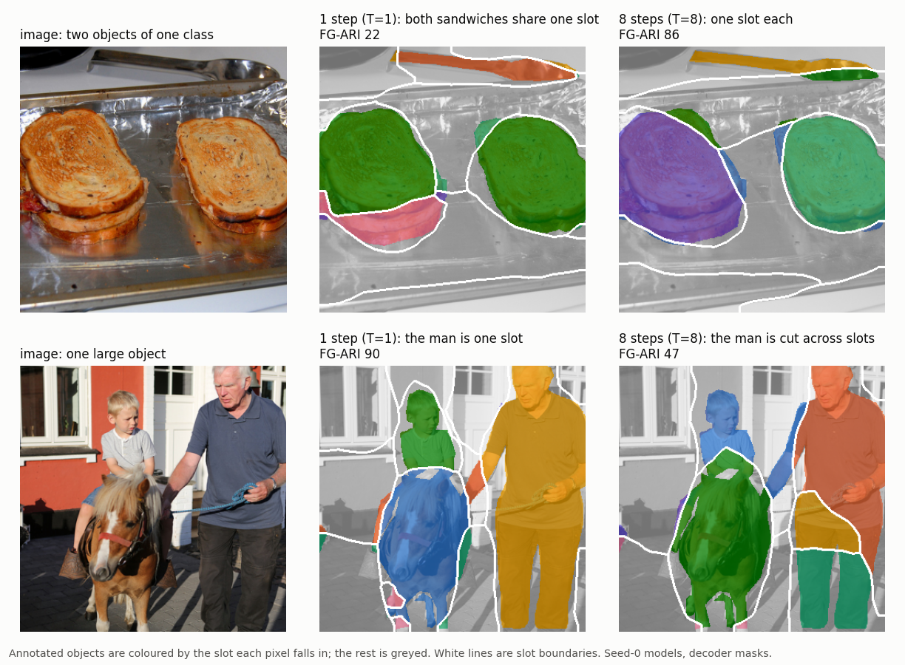
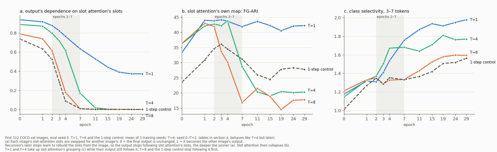
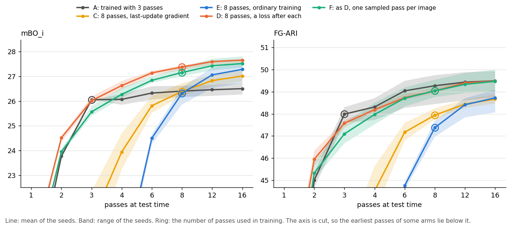

# DINO-TRM: does TRM-style recursion help slot-attention object discovery?

This repo adds a [Tiny Recursive Model](https://arxiv.org/abs/2510.04871)-style refinement
loop to a [DINOSAUR](https://arxiv.org/abs/2209.14860)-style object discovery model. Slot
attention sorts the patches of an image into 7 slots, each meant to hold one object. It
works on frozen DINOv3 ViT-S/16 features and is trained without labels to reconstruct
them. The loop is a small transformer module after slot attention, run once (T=1) or 8
times with shared weights (T=8).

**Short answer: no.** With 1 step, the model puts things that look alike into one slot,
even when they are separate objects. With 8 steps it divides the image into compact
regions instead. That separates look-alike objects, which the FG-ARI score rewards, and
cuts large objects, which it penalises. The net is about +1 FG-ARI while every other
score gets worse, and a plain distance penalty does the same without the extra steps.
A second experiment put the loop inside slot attention itself. That gave a small gain on
COCO which did not carry over to PASCAL VOC
([below](#recursion-inside-slot-attention)). Both experiments are finished, and this page
is their summary.



*Each colour is one slot; colours are not matched between the two models. Top: with 1
step both sandwiches land in one slot, and with 8 steps they get one each, which FG-ARI
rewards. Bottom: the same habit of dividing the
image into compact regions cuts the man across several slots, which FG-ARI penalises.
The two images were chosen to show the effects clearly, from one training seed. Single
images vary between seeds, so the claims rest on the table below. A random draw of
examples is in the [summary](results/coco/diagnostics/recursion_summary.md).*

## Results

3 training seeds per model, 2,000 COCO validation images, one evaluation seed. All
models have 6.40M trainable parameters. Masks are the decoder's unless stated.

FG-ARI asks whether each object's pixels share a slot and different objects don't,
ignoring background. mBO is the overlap of the best slot with each object (i) or each
class (c). "ARI counting background" is ARI with the background as one more segment.

| model | FG-ARI | mBO<sub>i</sub> | mBO<sub>c</sub> | ARI counting background | reconstruction error ×10³ |
|---|:--:|:--:|:--:|:--:|:--:|
| slot attention only (baseline) | 43.9 | 23.4 | 29.0 | 21.6 | 33.6 |
| + module, 1 step (T=1) | 45.8 | 25.7 | 32.9 | 24.1 | 29.7 |
| + module, 8 steps (T=8) | 47.0 | 25.2 | 31.1 | 22.0 | 33.6 |
| T=1 trained with a distance penalty, no extra steps | 46.7 | 25.1 | 31.0 | 22.5 | 33.1 |
| baseline, masks read from slot attention's own attention map | 48.0 | 26.1 | 32.8 | 25.0 | 33.6 |

- **8 steps trade one score for the others.** Against T=1, FG-ARI rises 1.2 points (1.0
  over three evaluation seeds). mBO<sub>i</sub> falls 0.5, mBO<sub>c</sub> 1.9 and ARI
  counting background 2.1, and reconstruction error rises 13%.
- **A distance penalty does the same in one step.** Penalising each mask's spread around
  its centre gives T=1 the same slots as T=8 and 79% of its FG-ARI gain.
- **Plain slot attention is not beaten.** Read from its own attention map, the baseline
  is ahead of both module models on FG-ARI and level or ahead on the other segmentation
  scores.

## Three things made a null result look like a gain

1. **A baseline that was too small.** The first comparison showed +4.2 FG-ARI for T=8,
   against a baseline with 3.89M parameters to T=8's 6.40M. With parameters matched the
   gap is 3.1.
2. **A weaker readout for the baseline.** A model with the module can only be read
   through the decoder. The baseline can also be read from slot attention's attention
   map, and there it scores 48.0, above T=8's 47.0.
3. **A metric that rewards dividing the image by position.** FG-ARI counts two objects
   of one class in one slot as an error and ignores background. T=8 gains 2.2 points in images
   with two far-apart objects of one class and loses 2.8 in images with none.

## What the 8 steps do instead



*(a) How far the output still follows slot attention's slots: 1 is fully, 0 is not at
all. (b) FG-ARI of slot attention's own map. (c) How strongly the output groups by
class. "1-step control" is T=8 with the gradient cut between steps, as TRM trains.*

- **The module takes over from slot attention.** It reads the image itself through
  cross-attention. Trained with more steps, it stops using slot attention's slots and
  builds its own (a), and slot attention stops segmenting (b).
- **That is not specific to recursion.** It happens sooner with a separate block per
  step than with shared weights. Without the module's cross-attention, 8 steps change
  nothing (one seed).
- **Only the small shared block trained from scratch then divides the image by position.** A wider
  shared block, separate blocks, and the same block started from T=1's weights all keep
  T=1's grouping by appearance.
- **Shared weights add nothing measurable.** At equal depth and parameters they score
  0.6 FG-ARI below separate blocks.

## Recursion inside slot attention

Slot attention is already a loop: it repeats one update 3 times. Instead of adding a
module after it, that loop can be given TRM's recipe directly: 8 passes, a loss after
each, and the gradient cut between them.

```
in a module (above):      patches -> slot attention x3 -> [ module ] x8 -> decoder
inside slot attention:    patches -> [ slot attention ] x8 ---------------> decoder
```

**Short answer: a small gain on COCO, and none on PASCAL VOC.**

COCO, 3 seeds per row, masks read from slot attention's own attention map. Every model
has the baseline's 6.40M parameters. B is the reference for the 8-pass models: the
baseline's own weights, run for 8 passes.

| | slot attention trained with | passes at test time | FG-ARI | mBO<sub>i</sub> | mBO<sub>c</sub> | ARI counting background |
|---|---|:--:|:--:|:--:|:--:|:--:|
| A | 3 passes (the baseline) | 3 | 48.0 | 26.1 | 32.8 | 25.0 |
| B | the same weights as A | 8 | 49.3 | 26.4 | 33.1 | 25.2 |
| C | 8 passes, gradient from the last update only | 8 | 47.9 | 26.4 | 33.6 | 25.1 |
| E | 8 passes, one loss at the end | 8 | 47.4 | 26.3 | 33.3 | 24.9 |
| D | 8 passes, a loss after each | 8 | 49.0 | 27.4 | 34.4 | 25.9 |
| F | as D, with each image decoded at one randomly drawn pass | 8 | 49.0 | 27.2 | 34.1 | 25.7 |



*Line: mean of 3 seeds. Band: their range. With a loss after each pass (D, F),
mBO<sub>i</sub> pulls ahead of the baseline after pass 3. C and E need 8 passes to reach
the baseline and are still rising at 16. On FG-ARI no model ends above the baseline.*

- **A loss after each pass adds about 1 point of mBO.** Against B, D gains 0.98
  mBO<sub>i</sub> [0.78, 1.18] and F gains 0.75 [0.56, 0.95] (95% intervals from
  resampling images). On mBO<sub>i</sub>, every seed of D and of F is above every seed
  of B, C and E. D takes six times as long to train as the others (10.3 h against 1.6 to
  1.9 h). F is the cheap version, at 1.9 h.
- **Training with more passes is not enough by itself.** At 8 passes, C and E are level
  with B on mBO<sub>i</sub> (−0.01 and −0.09). Run for 16 passes they move ahead of the
  baseline, by 0.5 and 0.8 (E in two seeds of three), and F's lead over E shrinks from
  0.84 to 0.24. Much of what the per-pass loss buys is reaching that level in fewer
  passes.
- **FG-ARI does not improve.** D and F are level with B: both are 0.23 lower, with
  intervals that include zero. The 1-point rise over A is free, because A's own weights
  get it by running longer.
- **The gain did not replicate on PASCAL VOC.** With every model retrained on VOC, F
  against B is −0.14 mBO<sub>i</sub> [−0.53, +0.24] and −0.96 FG-ARI [−1.61, −0.34].
  The test was fixed before these runs: a mean gain of at least 0.5 mBO<sub>i</sub> over
  each control, positive in every seed, with no other score falling.
- **F's decoder masks are better on both datasets,** by 0.84 mBO<sub>i</sub> on COCO and
  0.85 on VOC, in every seed (against the baseline's decoder masks at 3 passes, where
  they are best). This was not the comparison fixed in advance, and the decoder's masks
  score 3 to 5 points below the attention map, so it is a secondary result.

A loss at every iteration is not a new idea. The slot-attention paper proposes it as a
remedy when training with more iterations and reports it helping set prediction
([Locatello et al., 2020](https://arxiv.org/abs/2006.15055), appendix), and row C is the
last-update training of [Chang et al. (2022)](https://arxiv.org/abs/2207.00787). What
this adds is the controlled comparison.

The module loop went wrong because the module has its own route from the image to the
slots and displaces slot attention. A longer slot-attention loop has one route.
[The two recursions](docs/two_recursions.md) draws both loops and has the full tables,
including VOC and a test of each model on the other dataset.

## Two checks worth reusing

- **A distance-penalty control for FG-ARI gains.** Train the reference model with a
  penalty on mask spread (`model.loc_bias`, `scripts/runs/run_coco_trm_t1_loc.sh`). If it
  matches the gain, the gain is grouping by position. Report mBO and ARI counting
  background next to FG-ARI.
- **A swap test for refiners.** Give the refiner another image's input slots and measure
  how far its output moves (`scripts/mechanism/handover.py`). If it doesn't move, the
  refiner has stopped refining.

## Limits

- **Small scale.** A 25k-image COCO subset, 23k training steps and a ViT-S backbone, on
  one 16 GB GPU. Scores are not comparable to published full-COCO results.
- **One design.** The takeover depends on the module reading the image and sitting
  behind slot attention.
- **Some controls are one seed.** The summary lists which.
- **Three seeds at most.** The intervals resample images, not training runs, so they
  understate the variation between seeds.

## More detail

- [The two recursions](docs/two_recursions.md): diagrams of the module loop and the
  slot-attention loop, how they differ, and the full slot-attention results.
- [Slot-attention loop reports](results/sa_loop): the report for each stage, the
  cross-dataset table and the per-image scores behind them.
- [Recursion summary](results/coco/diagnostics/recursion_summary.md): the evidence for
  the module results above, in three findings.
- [Mechanism report](results/coco/diagnostics/recursion_mechanism.md): every control and
  measurement.
- [Earlier analysis](docs/earlier_analysis.md): the first write-up, with the object-size
  analysis, the VOC runs, the discarded hypotheses, the model description and every
  training recipe. Its explanation of the FG-ARI gain is superseded.

## Run it

```bash
uv sync
uv run python -m pytest tests/ -q
uv run python scripts/build_coco_subset.py        # the 25k / 2k COCO subset
bash scripts/runs/run_coco.sh                     # T=8 and the first baseline, seed 0
bash scripts/runs/run_coco_controls.sh            # T=1, seed 0
bash scripts/runs/run_coco_capacity_controls.sh   # the parameter-matched baseline
bash scripts/runs/run_coco_trm_t1_loc.sh 40       # T=1 with the distance penalty
scripts/sa_loop/run_queue.sh stage1               # slot-attention loop: C and D, 3 seeds
scripts/sa_loop/run_queue.sh stage3               # E and F, 3 seeds
scripts/sa_loop/run_queue.sh stage4               # A, E and F on PASCAL VOC
```

DINOv3 is gated on Hugging Face: request access to
`facebook/dinov3-vits16-pretrain-lvd1689m`. A T=8 run takes about 4.7 h and a T=1 run
about 0.9 h on an RTX 5060 Ti. Each script trains several models. The other seeds and
recipes are in `scripts/runs/`, and the analysis pipeline is in
[scripts/mechanism/README.md](scripts/mechanism/README.md). The slot-attention loop is
scored with `scripts/sa_loop/eval_arms.py` and tabulated with `report.py`;
`scripts/sa_loop/env.sh` holds the Hugging Face cache path and needs editing on another
machine.
