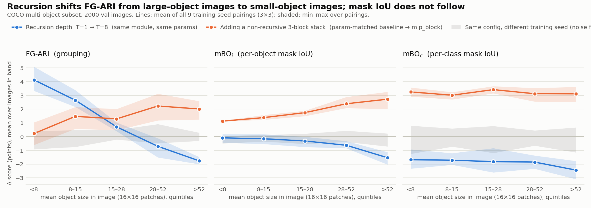
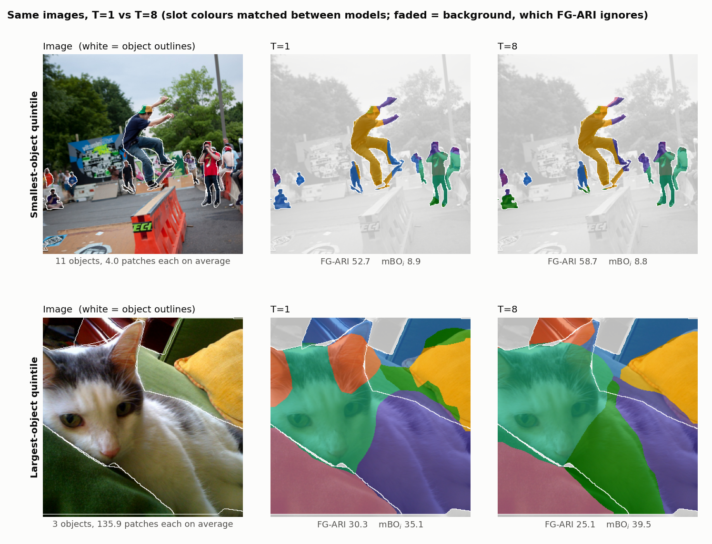

# DINO-TRM: does recursive reasoning help slot-attention object discovery?

> **Earlier analysis, kept for reference.** This was the main README until November 2026.
> Its tables are printed by `scripts/readme_tables.py` from the per-image results. Two of
> its conclusions are superseded by the [recursion summary](../results/coco/diagnostics/recursion_summary.md):
>
> - The explanation of the FG-ARI change in §2 ("contiguous and equal in size"). T=8's
>   slots group patches by position. Contiguity and even sizes follow from that, and
>   the object-size slope partly overlaps with it.
> - "The refinement module helps" in §1 holds for the decoder's masks only. Read from
>   slot attention's own attention map, the baseline scores 48.0 FG-ARI.

This repo adds a [Tiny Recursive Model](https://arxiv.org/abs/2510.04871)-style refinement
loop to a [DINOSAUR](https://arxiv.org/abs/2209.14860)-style object discovery model
(slot attention over frozen DINOv3 ViT-S/16 features, trained without labels to
reconstruct those features). The question was whether iterating on the slots, with
weights shared across steps, helps the model separate objects.

**Short answer: not in aggregate.** On a multi-object COCO subset, with
parameter-matched controls and 3 training seeds per arm:

- A **small transformer module after slot attention**, in which slots attend to each
  other and back to the patch features, helps on all three metrics (+2.4 mBO<sub>i</sub>,
  +4.0 mBO<sub>c</sub>, +2.0 FG-ARI at equal parameter count).
- **Recursing that module** (T=8 steps instead of T=1, same weights) does not help overall:
  +1.0 FG-ARI, −0.5 mBO<sub>i</sub>, −1.9 mBO<sub>c</sub>.
- The FG-ARI change from recursion depends strongly on object size: +4.1 on images with
  the smallest objects, −1.8 on images with the largest, in all 9 training-seed
  pairings. **It comes from two simple changes to the slots.** Recursion makes each slot
  more contiguous, so far-apart objects stop sharing a slot, which helps cluttered
  images. It also makes the slots more equal in size, which cuts large objects. Mask
  IoU doesn't follow, because most objects are far smaller than any slot. The effect
  does not appear on PASCAL VOC.

This is a research log and a controlled negative result, not a new method. Everything
was run on a single 16 GB consumer GPU. Every number below is printed by
`scripts/readme_tables.py` from the per-image evaluation files committed under
`results/`. The original hypotheses that did not survive are listed at the end.



## Setup

- **Model.** Frozen DINOv3 ViT-S/16 at 336 px (21×21 = 441 patch tokens) → slot attention
  (7 slots, 3 iterations) → optional refinement module → spatial-broadcast MLP decoder
  that reconstructs the DINOv3 features. Loss: feature MSE, applied after every
  recursion step (weight 0.25 on intermediate steps, 1.0 on the final one). Details in
  [How the model works](#how-the-model-works).
- **Data.** COCO 2017 subset: 25k train / 2k val images, each with ≥ 3 non-crowd
  instances covering ≥ 0.5 % of the image (`scripts/build_coco_subset.py`). This is
  **not** full COCO. It is selected on instance count, not occlusion. PASCAL VOC 2012 is
  used as a second dataset.
- **Training.** 30 epochs (≈ 23k steps at batch 32), AdamW, lr 4e-4, bf16. For
  scale, DINOSAUR trains for 500k steps. A T=8 run takes ≈ 4.7 h and a T=1 run ≈ 0.9 h
  on an RTX 5060 Ti.
- **Metrics** (`src/dino_trm/eval_protocol.py`, following the DINOSAUR protocol). Slot
  masks are upsampled to image resolution and scored against true COCO instance masks.
  - **FG-ARI**: are foreground pixels of the same object grouped into the same slot?
  - **mBO<sub>i</sub>**: best IoU of any slot with each object, averaged.
  - **mBO<sub>c</sub>**: the same, per semantic class.

  Slot initialisation is random at inference, so each model is evaluated with 3 eval
  seeds. That eval noise (median sd 0.15 FG-ARI) is much smaller than **training-seed**
  noise (sd up to 0.5), which is what the error bars below report.

## Findings

### 1. The refinement module helps; recursing it does not

COCO val, mean ± sd over **3 training seeds** per arm:

| arm | what sits between slot attention and decoder | params | mBO<sub>i</sub> | mBO<sub>c</sub> | FG-ARI |
|---|---|:--:|:--:|:--:|:--:|
| `baseline_pm` | nothing (decoder widened to match params) | 6.40 M | 23.36 ± 0.02 | 28.94 ± 0.04 | 43.81 ± 0.22 |
| `mlp_block` | 3 blocks (no weight sharing), applied once | 7.12 M | 25.23 ± 0.24 | 32.13 ± 0.18 | 45.26 ± 0.53 |
| `trm_t1` | TRM module (2 blocks), **1 recursion step** | 6.40 M | **25.72 ± 0.03** | **32.97 ± 0.11** | 45.79 ± 0.18 |
| `trm` | same module, **8 recursion steps** | 6.40 M | 25.17 ± 0.25 | 31.07 ± 0.51 | **46.80 ± 0.08** |

A block is self-attention over slots, cross-attention from slots to the 441 patch
features, and an FFN. `trm_t1` and `trm` have identical saved configs except `n_steps`.

Differences, mean over the 9 training-seed pairings, with [min, max] in brackets:

| contrast | Δ mBO<sub>i</sub> | Δ mBO<sub>c</sub> | Δ FG-ARI |
|---|:--:|:--:|:--:|
| add the module (`baseline_pm` → `trm_t1`) | +2.36 [+2.32, +2.40] | +4.02 [+3.86, +4.15] | +1.98 [+1.55, +2.31] |
| recurse it, T=1 → T=8 (`trm_t1` → `trm`) | −0.54 [−0.83, −0.28] | −1.90 [−2.43, −1.22] | +1.01 [+0.82, +1.30] |

Recursion is a trade-off rather than an improvement: it buys about 1 point of grouping
(FG-ARI) and costs about 2 points of per-class mask overlap.

### 2. Recursion shifts FG-ARI from large-object images to small-object images

The images were split into quintiles by the mean visible size of their objects,
measured in 16×16 patches. T=1 → T=8, mean over 9 training-seed pairings:

| mean object size (patches) | < 7.8 | 7.8–15.4 | 15.4–28.3 | 28.3–52.1 | > 52.1 |
|---|:--:|:--:|:--:|:--:|:--:|
| objects per image (mean) | 15.1 | 11.6 | 8.6 | 6.0 | 3.8 |
| **Δ FG-ARI** | **+4.13** | **+2.65** | +0.71 | **−0.71** | **−1.76** |
| range over 9 pairings | [+3.33, +5.09] | [+2.16, +3.39] | [+0.40, +1.03] | [−1.51, −0.12] | [−2.00, −1.48] |
| Δ mBO<sub>i</sub> | −0.09 | −0.15 | −0.32 | −0.63 | −1.53 |
| Δ mBO<sub>c</sub> | −1.68 | −1.72 | −1.82 | −1.85 | −2.43 |
| noise floor: max \|Δ FG-ARI\| between same-config seeds | 0.91 | 0.75 | 0.49 | 0.91 | 0.31 |

The pattern is robust:

- **It replicates across training seeds.** The signs are as shown in 36/36
  (pairing × outer-band) cells. The Spearman ρ between object size and per-image
  ΔFG-ARI lies in [−0.24, −0.19] for every pairing, against [−0.02, +0.03] for pairs of
  runs that differ only in seed.
- **It grows with depth** (single training seed at T=2 and T=4): smallest-object band
  +0.29 → +2.03 → +4.13, largest band −0.50 → −1.70 → −1.76.
- **It is object size, not object count or category.** Within terciles of object count
  the size trend stays (ρ −0.23 to −0.28); within terciles of object size the count
  trend disappears (ρ −0.07 to +0.02). Within person-dominated images alone (n = 768),
  ρ = −0.34.
- **It is not what extra capacity does.** The non-recursive 3-block stack (orange in the
  top figure) raises mask IoU at every size and helps FG-ARI most on large objects.

#### Why: recursion makes the slots contiguous and equal in size

Two changes to the slots, both measured without ground truth
(`scripts/slot_shape.py`, ranges over training seeds). A *piece* is an 8-connected
region of one slot covering at least one patch:

| | largest slot (% of image) | pieces per slot | slot pixels outside its main piece |
|---|:--:|:--:|:--:|
| `baseline_pm` | 27.5–27.9 | 1.10–1.11 | 2.5–2.7 % |
| `mlp_block` | 28.4–28.7 | 1.21–1.24 | 5.1–5.8 % |
| `trm_t1` | 28.4–28.7 | 1.26–1.27 | 6.2–6.3 % |
| `trm_t2` / `trm_t4` | 28.0 / 27.6 | 1.25 / 1.22 | 5.8 / 5.0 % |
| `trm` (T=8) | 26.3–26.8 | 1.15–1.19 | 2.8–3.9 % |

- **Fewer separate pieces.** Adding the module makes slots more fragmented. Recursion
  removes 29–46 % of the extra pieces, and the share of slot pixels outside the main
  piece falls from about 6 % to 3–4 %. Inside the T=8 model the count falls step by
  step (1.24 → 1.16 pieces per slot). When a slot's separate pieces hold different
  objects, every pixel pair across them is a wrong pair for FG-ARI.
- **More equal slot sizes.** The largest slot shrinks by about 2 points of the image.
  Unlike contiguity, this is already in place at the T=8 model's first step.

Applying each change by hand to the T=1 model, with no ground truth and no retraining,
reproduces one end of the size pattern each. FG-ARI change at eval seed 0, mean over
the 9 pairings (real) or the 3 T=1 training seeds (interventions):

| mean object size | smallest | | | | largest | all |
|---|:--:|:--:|:--:|:--:|:--:|:--:|
| real T=1 → T=8 | +4.54 | +2.98 | +1.10 | −0.66 | −2.01 | +1.19 |
| T=1, each slot cut into its separate pieces | +3.35 | +1.79 | +0.76 | −0.02 | −0.53 | +1.07 |
| T=1, slot sizes evened out to T=8's level | +1.14 | +0.40 | −0.28 | −1.05 | −1.76 | −0.31 |

Evening out adds a per-slot bias to the mask logits, b<sub>k</sub> = −λ log(share of
the image in slot k), with λ set so the largest slot is as small as at T=8. Cutting
into pieces adds segments only where a slot was already in pieces, and changes
large-object images by just −0.5.

**Why mask IoU doesn't follow.** 49 % of objects cover fewer than 4 patches, and their
best IoU is 2.3 at both T=1 and T=8: whichever objects share their slot, the slot is
far bigger than they are. The only clear change is on objects over 64 patches (9 % of
objects, IoU −1.7), which the more equal slots cut. I have not analysed the
mBO<sub>c</sub> loss.

The examples below, chosen by a fixed rule (`scripts/make_readme_figures.py`), show
both effects:



- **Top (11 objects, 4 patches each).** At T=1 one slot (blue) covers parts of 8 of the
  11 objects; at T=8 that group is split across two slots. FG-ARI rises 6 points while
  mBO<sub>i</sub> is unchanged (8.9 vs 8.8): no object is segmented better.
- **Bottom (3 objects, 136 patches each).** At T=8 the cat is spread more evenly across
  three slots (its third slot grows from 13 % to 24 % of it), and FG-ARI falls 5 points.

So recursion does not segment objects better. It changes the shape of the partition,
which FG-ARI rewards on cluttered images and penalises on large objects.

### 3. It does not transfer to PASCAL VOC

The same recipe was trained on VOC (single training seed; instances are connected
components of the semantic masks, as in DINOSAUR). The result uses the same
absolute size bands:

| Δ FG-ARI, T=1 → T=8 | < 8 | 8–16 | 16–32 | 32–64 | 64+ | overall | ρ |
|---|:--:|:--:|:--:|:--:|:--:|:--:|:--:|
| COCO (3×3 seeds) | +4.12 | +2.36 | +0.43 | −0.80 | −1.85 | +1.01 | −0.30 |
| VOC (1×1 seed) | −0.02 | +2.91 | +1.12 | +0.24 | −0.21 | +0.38 | −0.06 |

On VOC the smallest band shows nothing (n = 147). Recursion again costs mBO<sub>i</sub>
on the largest objects (−1.11). I tested four explanations for the difference, and
none of them accounts for it (size ρ of the T=1 → T=8 FG-ARI change):

| candidate explanation | test | ρ |
|---|---|:--:|
| — | COCO, as reported | −0.30 |
| VOC's instances are connected components, which merge touching same-class objects | score COCO against connected-component instances | −0.29 |
| the VOC models learned something different | run the COCO-trained checkpoints on VOC images | −0.09 |
| VOC has few objects per image (median 2, against 7 slots) | COCO images with ≤ 3 objects (n = 345) | −0.24 |
| VOC has more large-object images (41 % vs 14 % above 64 patches) | resample COCO to VOC's size mix | −0.21 [−0.26, −0.16] |
| — | VOC, as reported | −0.06 |

On VOC images, the COCO-trained checkpoints show only the weak VOC-level trend. So
the difference lies in the VOC evaluation data, not in how the models were trained.
Within that data it is not the instance definition, the object count or the size
mix. The main untested candidate is annotation coverage: VOC labels only 20 classes,
so objects of other classes count as background and FG-ARI never scores them.

For reference, the VOC runs score mBO<sub>i</sub> 36.9 / 39.3 / 38.8 and
FG-ARI 20.6 / 21.4 / 21.8 for `baseline_pm` / `trm_t1` / `trm`. DINOSAUR reports
39.5 and 24.6 (ViT-B/16, MLP decoder, Table 3), with a different backbone and 500k
steps.

### 4. Hypotheses that did not survive

These are single-training-seed runs (mean over 3 eval seeds), so treat differences
under about 0.5 FG-ARI as noise:

| run | params | mBO<sub>i</sub> | mBO<sub>c</sub> | FG-ARI |
|---|:--:|:--:|:--:|:--:|
| `baseline` (original, decoder 1024) | 3.89 M | 22.91 | 28.56 | 42.52 |
| `baseline`, 9 / 11 / 15 slots | 3.89 M | 24.29 / 24.82 / 25.70 | 28.57 / 28.26 / 27.73 | 41.35 / 39.14 / 35.95 |
| `baseline_dinosaur` (DINOSAUR's COCO architecture) | 11.25 M | 23.97 | 29.29 | 46.36 |
| `baseline_pm13` (decoder widened to 13.35 M) | 13.35 M | 23.80 | 29.03 | 46.04 |
| `coupled` (T=8 + re-run slot attention each step) | 6.40 M | 25.05 | 30.90 | 47.20 |
| `coupled_dec2048` | 13.35 M | 26.29 | 32.24 | 49.67 |

- **"Recursion gives +4–5 FG-ARI."** That was the first headline, measured against
  `baseline`. Most of it was an under-provisioned baseline. Giving the baseline
  DINOSAUR's own COCO architecture (`baseline_dinosaur`) closes the FG-ARI gap to
  +0.4 vs `trm`. The parameter-matched 3-seed comparison in §1 is the fair one.
- **"Coupled re-binding separates touching objects."** This was the original motivation.
  `coupled` vs `trm` at the same training seed is +0.47 FG-ARI with no mBO change,
  which is within training-seed noise.
  `coupled_dec2048` is the best model here (49.67), but it has one seed, and its
  comparison to `baseline_pm13` confounds the block, recursion and coupling. I have not
  replicated it.
- **"The baseline just has too few slots."** More slots raise mBO<sub>i</sub> (more
  segments to match objects with) but lower FG-ARI steadily (over-segmentation), so
  slot count does not explain the gaps above.
- **"Recursion helps in crowded scenes."** Object count was a proxy for object size
  (§2).
- **"The COCO subset is occlusion-rich."** It isn't: the subset is selected on instance
  count. Occlusion was never measured well enough to test anything.

## Limitations

- **It is a partition effect, not better segmentation.** Recursion makes the slots more
  contiguous and more equal in size (§2). FG-ARI rewards that on cluttered images, but
  no object is segmented better. Why training with recursion produces contiguous slots
  is not explained.
- **The slot-shape analysis uses one eval seed**, and the two interventions in §2 are
  tested separately, not together.
- **One dataset.** The effect is absent on VOC. A MOVi-C run (`scripts/runs/run_movi.sh`)
  has T=1 trained, but T=8 stopped at epoch 3 of 30 and is not reported.
- **Short training** (≈ 23k steps vs DINOSAUR's 500k) on a 25k-image subset, with a
  ViT-S backbone. Absolute numbers are not comparable to published full-COCO results.
- **T=1 vs T=8 also differs in deep supervision.** T=8 receives a loss on 7
  intermediate steps as well.
- **Development used the val set.** Every run is scored at its final epoch, with no
  checkpoint selection. But design decisions were made while looking at val numbers.
- The single-seed rows in §4 are unreplicated.

## Future work

- **Why are recursive slots contiguous?** Train T=8 with a loss on the final step only,
  to separate recursion from deep supervision. Measure slot pieces on VOC: if the VOC
  T=1 slots are already contiguous, recursion has nothing to fix there, which would
  explain the VOC null.
- **Test annotation coverage** as the VOC explanation: re-score COCO with only VOC's
  20 classes as foreground.
- **Finish MOVi-C T=8.** It is synthetic, has complete ground truth, and covers a wide
  size range. It is the cleanest second-dataset test.
- **Resolution sweep.** If the effect is about objects below the patch grid, the
  crossover should sit at a fixed *patch* count when training at 224 / 448 px.
- **Adaptive depth (ACT halting).** The halting head is implemented (`loss.act_weight`)
  but off. An upper bound is informative here. Choosing T=1 or T=8 per image with the
  ground truth, cross-validated across eval seeds, gives FG-ARI ≈ 48.2 vs 46.7 for T=8.
  Scoring on the same draws used for selection inflates this to ≈ 50.3.
- **Bigger backbone.** Does richer patch information benefit more from recursion, or
  does a better starting point leave less for recursion to do?
- **Cheaper training across depths.** Train each depth t = 1…8 with its own loss and
  update, reusing the weights from depth t−1 so each stage only computes one more
  step. Is that more data-efficient?

## How the model works

For a 336×336 image:

1. **Frozen DINOv3 ViT-S/16** (`models/backbone.py`), bf16, `no_grad`: 441 patch
   features (21×21), 384-dim.
2. **Projection** to slot dim: LayerNorm + Linear, 384 → 256. `model.pre_sa_mlp=true`
   uses DINOSAUR's two-layer MLP instead.
3. **Slot attention** (`models/slot_attention.py`): 7 slots sampled from a learned
   Gaussian. For 3 iterations, slots compete for patches with a softmax over slots and
   update through a GRU. The softmax and GRU run in fp32, because bf16 underflow kills
   slots.
4. **Refinement** (the modes compared above):
   - `baseline`: nothing.
   - `mlp_block` (`models/mlp_block.py`): 3 distinct blocks applied once.
   - `trm` (`models/trm_module.py`, `models/tiny_gnn.py`): a 2-block module applied T
     times with shared weights. It carries TRM's three streams per slot: `x` = the
     slot-attention output, `y` = the current slot estimate, `z` = a latent state. Each
     step updates `z`, then reads `y` out of it. With
     `model.gnn_cross_attn=true` (all reported runs), each step also cross-attends from
     slots to the patches. Full BPTT through all T steps, which
     `tests/test_recursion_grad.py` checks.
   - `coupled`: like `trm`, but slot attention is re-run every step, conditioned on the
     latent (`x_t = SlotAttention(patches, z_{t-1})`), so the patch assignment can
     change between steps. Needs `loss.query_ortho_weight=0.1`; without it, slots
     collapse into one.
5. **Spatial broadcast decoder** (`models/decoder.py`): each slot is broadcast over the
   21×21 grid with a positional code. A 4-layer MLP predicts features plus an alpha
   logit, and the output is the alpha-weighted sum over slots.
6. **Loss**: MSE to the DINOv3 features at every recursion step (deep supervision).

The argmax over the upsampled alpha masks gives each pixel a slot id, which is what
the metrics score.

## Reproducing

```bash
uv sync
uv run python -m pytest tests/ -q                 # includes the full-BPTT gradient check
uv run python scripts/sanity_check.py             # backbone forward pass
```

DINOv3 is gated on Hugging Face: request access to
`facebook/dinov3-vits16-pretrain-lvd1689m`. `model.model_id=facebook/dinov2-small` is an
open fallback, but it was not used for any result here.

**Tables and figures from the committed per-image results (no GPU or checkpoints needed):**

```bash
uv run python scripts/readme_tables.py            # every number in this README
uv run python scripts/make_readme_figures.py size # results/figures/size_tradeoff.png
uv run python scripts/size_profile.py --contrast trm_t1:trm   # bootstrap CIs per band
```

**From scratch** (checkpoints are not in the repo):

```bash
uv run python scripts/build_coco_subset.py        # 25k/2k subset, downloads only those JPGs
bash scripts/runs/run_coco.sh                     # baseline, trm, coupled (seed 0)
bash scripts/runs/run_coco_controls.sh            # mlp_block, trm_t1 (seed 0)
bash scripts/runs/run_coco_capacity_controls.sh   # baseline_pm, coupled_dec2048
bash scripts/runs/run_coco_crowding_seeds.sh      # seeds 1, 2 of trm_t1 / trm / mlp_block
bash scripts/runs/run_coco_baseline_pm_seeds.sh   # seeds 1, 2 of baseline_pm
bash scripts/runs/run_coco_t_sweep.sh             # trm_t2, trm_t4
bash scripts/runs/run_coco_slot_sweep.sh          # 9/11/15 slots + a seed-1 baseline
bash scripts/runs/run_coco_faithful_baseline.sh   # baseline_dec2048, baseline_dinosaur
bash scripts/runs/run_voc_coco_matched.sh         # VOC with the COCO recipe
uv run python scripts/extract_per_image.py --runs trm_t1,trm,...   # per-image metrics
uv run python scripts/make_readme_figures.py examples              # needs checkpoints
uv run python scripts/coco_voc_style_gt.py    # §3 (a): COCO vs connected-component GT
uv run python scripts/transfer_eval.py        # §3 (b): COCO-trained models on VOC
uv run python scripts/class_confound.py       # §2: size vs category
uv run python scripts/slot_shape.py --runs trm_t1,trm_t1_seed1,trm_t1_seed2 --sweep  # §2 slot shape
uv run python scripts/slot_shape.py --runs trm,trm_seed1,trm_seed2,trm_t2,trm_t4,baseline_pm,baseline_pm_seed1,baseline_pm_seed2,mlp_block,mlp_block_seed1,mlp_block_seed2
```

The outputs of those last five commands are committed, so `readme_tables.py` doesn't
need them re-run.

Comments inside the run scripts record the reasoning at the time they were written.
Some of the hypotheses they mention were later retired (§4).

## Layout

```
src/dino_trm/
  models/          backbone, slot_attention, decoder, tiny_gnn, trm_module, mlp_block, full_model
  data/            coco (multi-object subset, true instance masks), pascal_voc, voc_imageonly,
                   movi + tfrecord (MOVi-C, in progress)
  losses.py        reconstruction + deep supervision (+ ACT halting, query orthogonality)
  train.py         Hydra training loop, bf16 autocast
  eval_protocol.py full-resolution mBO_i / mBO_c / FG-ARI
configs/           base.yaml (all defaults), pascal_voc.yaml
scripts/           data prep, eval_published (aggregate eval), extract_per_image (per-image eval),
                   readme_tables, make_readme_figures, size_profile, segment_count_check,
                   class_confound, coco_voc_style_gt, transfer_eval, slot_shape,
                   MOVi download/prep
scripts/runs/      training recipes for every run above
results/           per-run training curves; per_image/*.npz = the evaluation data behind the tables
tests/             slot attention, TinyGNN, full-BPTT gradient check, mlp_block, losses
```
