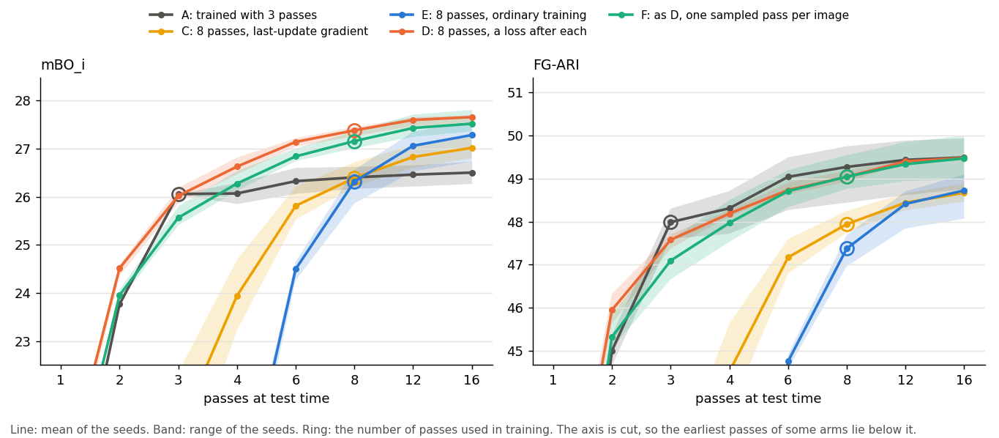

# The two recursions

This project ran two loops. Both repeat one block with the same weights, and both were
trained with a loss after every pass. They differ in where the loop sits:

```
in a module (the main experiment):   patches -> slot attention x3 -> [ module ] x8 -> decoder
inside slot attention:               patches -> [ slot attention ] x8 ---------------> decoder
```

The first did not help. The second gave a small gain on COCO that did not carry over to
PASCAL VOC. The numbers are at the end.

## What both share

```
image -> frozen DINOv3 -> 441 patch features -> ... -> 7 slots -> decoder -> rebuilt features
         (not trained)    (21 x 21 grid)                                      |
                                                    loss = error against the real features
```

- **Slots.** 7 vectors, each meant to describe one object.
- **Decoder.** Each slot is copied to all 441 positions with a position code. An MLP turns
  each copy into features and one mask value. At every patch the 7 mask values compete,
  and the output is the mask-weighted sum of the features.
- **Training.** No labels. The only signal is how well the patch features are rebuilt.

## 1. Recursion inside slot attention

```
                          441 patch features
                                  |
                                  v
                 +----------------------------------+
7 random slots   |  slot-attention update           |
(first pass) --> |  a. every patch splits one vote  |
                 |     across the 7 slots           |
       +-------> |  b. each slot averages the       |
       |         |     patches that voted for it    |
       |         |  c. a GRU and an MLP update      |
       |         |     the slot                     |
       |         +----------------------------------+
       |                          |
       |                          v
       +--- next pass -------- 7 slots -> decoder -> loss
            (same weights)
```

- **Baseline:** 3 passes, one loss after the last.
- **Recursion:** 8 passes, a loss after every pass, and the gradient cut between passes,
  so each loss trains one update. This is how TRM trains its steps.
- **Cheaper version:** the same, but in each training step every image is decoded at
  one pass only. The pass is drawn at random, the last one four times as often as each
  earlier one, which matches the loss weights (1 for the last pass, 0.25 for the
  others). A step then costs one decode per image instead of 8.
- **Nothing is added.** The model has the baseline's 6.40M parameters.
- **The patches do the choosing.** Each patch has one vote to split, so the slots compete
  for patches and each patch ends up mostly with one slot. That map of votes is itself a
  segmentation, and it can be scored directly.

Code: `src/dino_trm/models/slot_attention.py`; run with `mode=sa_rec model.slot_iters=8
model.sa_detach=true` (`scripts/runs/run_coco_sa_rec_1step.sh`), and add
`model.sa_sample_pass=true` for the cheaper version. `scripts/sa_loop/run_queue.sh` holds
every recipe used in the results below.

## 2. Recursion in a module after slot attention

```
                          441 patch features --------------------+
                                  |                              |
                                  v                              |  the module reads
                      slot attention, 3 passes                   |  the patches itself,
                                  |                              |  at every step
                                  v                              |
                       x = its 7 slots (kept fixed)              |
                                  |                              |
                                  v                              v
                 +----------------------------------------------------+
y starts as x    |  module step                                       |
z starts as  --> |  a. mix x, y and z                                 |
a learned vector |  b. 2 layers: the slots attend to each other, then |
                 |     each slot attends to the patches, then an MLP  |
       +-------> |  c. update the latent z                            |
       |         |  d. run a and b again, then update the slots y     |
       |         +----------------------------------------------------+
       |                          |
       |                          v
       +--- next step ------- y and z -> decoder(y) -> loss
            (same weights)
```

- **T=1:** one step. **T=8:** 8 steps, a loss after every step, and the gradient passed
  through all of them. One control cuts the gradient between steps instead.
- **x, y, z** are TRM's three streams: the question (slot attention's slots), the current
  answer (the slots being refined) and a latent state.
- **The module adds 2.5M parameters.** The baseline's decoder is widened so that both
  have 6.40M.
- **The slots do the choosing.** Each slot spreads its attention over all 441 patches.
  Nothing stops two slots from reading the same patches. They coordinate only by
  attending to each other.
- **Masks can only be read from the decoder,** because the module changes the slots
  after slot attention has made its map.

Code: `src/dino_trm/models/trm_module.py` and `tiny_gnn.py`; run with `mode=trm
model.gnn_cross_attn=true model.n_steps=8`.

## The difference that matters

| | inside slot attention | in a module |
|---|---|---|
| what is repeated | slot attention's own update | a transformer block added after it |
| starts from | random slots | slot attention's finished slots |
| who chooses | patches choose slots, so slots compete | slots choose patches, with no competition |
| routes from the image to the slots | one | two: through slot attention, and through the module's own reads |
| extra parameters | none | 2.5M |
| masks read from | slot attention's map, or the decoder | the decoder only |

The two routes are why the module loop went wrong. With enough steps the module learns
to build the slots from its own reads, stops using slot attention's slots, and slot
attention stops segmenting. What the small shared block then builds is slots divided by
position ([summary](../results/coco/diagnostics/recursion_summary.md), section 2).
A longer slot-attention loop has one route, so there is nothing to displace.

The two blocks also behave differently when simply run for longer than they were
trained for, with no retraining (FG-ARI, 3 seeds):

| passes at test time | 1 | 2 | 3 | 5 | 8 | 16 |
|---|---|---|---|---|---|---|
| baseline slot attention, trained with 3 (its map) | 33.8 | 45.0 | 48.0 | 48.9 | 49.3 | 49.5 |

| steps at test time | 1 | 2 | 4 | 8 |
|---|---|---|---|---|
| module, trained with 1 step (T=1) | 45.8 | 32.7 | 21.5 | 15.1 |

Slot attention's update settles and improves. The module's update, repeated, falls apart
unless it was trained that way.

## Results: the module loop

3 seeds on the 2,000 COCO validation images.

| model | masks read from | FG-ARI | mBO<sub>i</sub> | mBO<sub>c</sub> | reconstruction error ×10³ |
|---|---|:--:|:--:|:--:|:--:|
| slot attention, 3 passes (baseline) | its map | 48.0 | 26.1 | 32.8 | 33.6 |
| slot attention, 3 passes (baseline) | decoder | 43.9 | 23.4 | 29.0 | 33.6 |
| module, T=1 | decoder | 45.8 | 25.7 | 32.9 | 29.7 |
| module, T=8 | decoder | 47.0 | 25.2 | 31.1 | 33.6 |

Neither module model beats the baseline read from its own map. The
[README](../README.md) and the [summary](../results/coco/diagnostics/recursion_summary.md)
cover why.

## Results: the slot-attention loop

**In brief.** On COCO, a loss after each pass raises mBO by about 1 point, at close to
the baseline's training cost. FG-ARI does not improve, and the gain did not replicate on
PASCAL VOC.

### The models and the test

Six arms, 3 seeds each. All have 6.40M parameters, 7 slots and the baseline's recipe.

| arm | slot attention trained with | runs |
|---|---|---|
| A | 3 passes, one loss at the end (the baseline) | `baseline_pm*` |
| B | nothing new: A's weights, run for 8 passes at test time | |
| C | 8 passes, one loss, gradient from the last update only (Chang et al., 2022) | `sa8_last*` |
| E | 8 passes, one loss, gradient through all passes | `sa8_full*` |
| D | 8 passes, a loss after each, gradient cut between passes | `sa_rec_1step*` |
| F | as D, but each image is decoded at one pass drawn at random | `sa8_rand*` |

On an RTX 5060 Ti, C, E and F trained in 1.6, 1.7 and 1.9 hours per run, and D in 10.3.

The test is fixed in `scripts/sa_loop/report.py`:

- The method (D, later F) must beat each control on mBO<sub>i</sub>: a mean of at least
  +0.5, a 95% interval above 0, and all three seed pairs above 0.
- Its interval must not lie entirely below 0 on FG-ARI, mBO<sub>c</sub> or ARI counting
  background.
- The controls are B and C for D; B, C and E for F; and B and E on VOC.

Each image's difference is averaged over the three seed pairs, and the interval comes
from resampling images. The rule was written after seed 0 of D had been trained and
before every other run it judges. The script entered the repository after the runs, so
the git history does not show this.

### COCO

Slot attention's map, mean of 3 seeds, 2,000 validation images:

| arm | passes at test time | FG-ARI | mBO<sub>i</sub> | mBO<sub>c</sub> | ARI counting background | reconstruction error ×10³ |
|---|:--:|:--:|:--:|:--:|:--:|:--:|
| A | 3 | 47.99 | 26.06 | 32.83 | 24.98 | 33.57 |
| B | 8 | 49.27 | 26.40 | 33.13 | 25.15 | 36.19 |
| C | 8 | 47.94 | 26.39 | 33.63 | 25.11 | 31.27 |
| E | 8 | 47.38 | 26.32 | 33.28 | 24.87 | 37.25 |
| D | 8 | 49.04 | 27.38 | 34.37 | 25.92 | 30.95 |
| F | 8 | 49.05 | 27.16 | 34.14 | 25.67 | 31.34 |

The decoder's masks, same models and passes:

| arm | FG-ARI | mBO<sub>i</sub> | mBO<sub>c</sub> | ARI counting background |
|---|:--:|:--:|:--:|:--:|
| A | 43.89 | 23.39 | 29.01 | 21.56 |
| B | 41.10 | 23.05 | 28.37 | 20.87 |
| C | 43.56 | 23.82 | 29.95 | 21.91 |
| E | 43.22 | 23.15 | 28.69 | 21.13 |
| D | 44.55 | 24.44 | 30.34 | 22.58 |
| F | 44.41 | 24.23 | 30.06 | 22.31 |

Differences on the map, both models at 8 passes: mean [95% interval], then the three
seed pairs. "Welch p" is a Welch test on the three seed means of each arm. It is not
corrected for the number of comparisons.

| contrast | mBO<sub>i</sub> | seed pairs | Welch p | FG-ARI |
|---|---|---|:--:|---|
| D − B | +0.98 [+0.78, +1.18] | +0.64 / +1.05 / +1.24 | 0.009 | −0.23 [−0.70, +0.23] |
| D − C | +0.99 [+0.80, +1.19] | +1.03 / +1.24 / +0.70 | 0.018 | +1.10 [+0.65, +1.53] |
| D − E | +1.07 [+0.87, +1.27] | +1.41 / +0.89 / +0.89 | 0.036 | +1.67 [+1.20, +2.14] |
| F − B | +0.75 [+0.56, +0.95] | +0.46 / +0.96 / +0.84 | 0.012 | −0.23 [−0.66, +0.20] |
| F − C | +0.77 [+0.58, +0.96] | +0.85 / +1.15 / +0.30 | 0.023 | +1.10 [+0.67, +1.53] |
| F − E | +0.84 [+0.65, +1.04] | +1.23 / +0.81 / +0.49 | 0.048 | +1.67 [+1.23, +2.11] |
| D − F | +0.22 [+0.05, +0.40] | +0.18 / +0.09 / +0.40 | 0.16 | −0.00 [−0.38, +0.38] |
| C − B | −0.01 [−0.23, +0.20] | −0.39 / −0.19 / +0.54 | 0.96 | −1.33 [−1.81, −0.82] |
| E − B | −0.09 [−0.27, +0.09] | −0.77 / +0.15 / +0.35 | 0.76 | −1.90 [−2.34, −1.45] |

- **D and F pass the test against every control.** On mBO<sub>i</sub>, each of their
  seeds is above every seed of B, C and E. mBO<sub>c</sub> rises with it: +1.24
  [+0.99, +1.49] for D over B and +1.01 [+0.79, +1.24] for F.
- **F keeps three quarters of D's gain** over B (0.75 of 0.98) for under a fifth of the
  training time.
- **More passes in training do not help by themselves at 8 passes.** C and E are level
  with B on mBO<sub>i</sub> and below it on FG-ARI.
- **FG-ARI does not improve.** D and F are level with B. The 1-point rise over A is what
  A's own weights get from running 8 passes.

### Passes at test time



mBO<sub>i</sub> of slot attention's map, mean of 3 seeds:

| passes at test time | 1 | 2 | 3 | 4 | 6 | 8 | 12 | 16 |
|---|---|---|---|---|---|---|---|---|
| A | 18.1 | 23.8 | 26.1 | 26.1 | 26.3 | 26.4 | 26.5 | 26.5 |
| C | 14.6 | 16.4 | 21.1 | 23.9 | 25.8 | 26.4 | 26.8 | 27.0 |
| E | 16.2 | 17.0 | 17.5 | 19.1 | 24.5 | 26.3 | 27.1 | 27.3 |
| D | 19.7 | 24.5 | 26.0 | 26.6 | 27.1 | 27.4 | 27.6 | 27.7 |
| F | 19.0 | 24.0 | 25.6 | 26.3 | 26.8 | 27.2 | 27.4 | 27.5 |

Against A, both at 16 passes:

| arm | mBO<sub>i</sub> | seed pairs |
|---|---|---|
| C | +0.51 [+0.29, +0.74] | +0.27 / +0.31 / +0.97 |
| E | +0.78 [+0.59, +0.97] | −0.01 / +1.05 / +1.29 |
| F | +1.02 [+0.81, +1.22] | +0.64 / +1.32 / +1.09 |
| D | +1.15 [+0.94, +1.37] | +0.82 / +1.21 / +1.42 |

- **Every model trained with 8 passes ends above the baseline when run for 16,** E in
  two seeds of three. F's lead over E shrinks from 0.84 at 8 passes to 0.24
  [+0.05, +0.43] at 16, with seed pairs +0.64 / +0.27 / −0.20.
- **The per-pass loss gets there in fewer passes.** D and F have a usable map from the
  second pass. E has none before about pass 6, and C none before about pass 4.
- **C and E are still rising at 16 passes,** so the level they settle at is not known.
- **FG-ARI at 16 passes is 49.5 for A, D and F,** and 48.7 for C and E.
- These comparisons at 16 passes were made after the results were seen. The test above
  was at 8.

### PASCAL VOC

Every arm retrained on VOC, 3 seeds, 1,449 validation images. This pipeline has no
instance labels for VOC, so an object there is a connected region of one class mask.
Slot attention's map:

| arm | passes at test time | FG-ARI | mBO<sub>i</sub> | mBO<sub>c</sub> | ARI counting background | reconstruction error ×10³ |
|---|:--:|:--:|:--:|:--:|:--:|:--:|
| A | 3 | 23.16 | 41.84 | 45.86 | 19.53 | 32.43 |
| B | 8 | 24.85 | 42.25 | 45.95 | 19.25 | 34.03 |
| E | 8 | 22.49 | 41.81 | 46.07 | 18.64 | 36.39 |
| F | 8 | 23.89 | 42.10 | 45.89 | 19.65 | 30.50 |

| contrast | mBO<sub>i</sub> | seed pairs | FG-ARI |
|---|---|---|---|
| F − B | −0.14 [−0.53, +0.24] | −0.30 / −0.13 / +0.00 | −0.96 [−1.61, −0.34] |
| F − E | +0.29 [−0.11, +0.69] | +0.29 / +0.07 / +0.53 | +1.40 [+0.76, +2.04] |
| E − B | −0.44 [−0.84, −0.05] | −0.58 / −0.20 / −0.53 | −2.36 [−3.05, −1.70] |

- **The test fails.** F is level with B on mBO<sub>i</sub> and below it on FG-ARI in all
  three seeds.
- **Ordinary 8-pass training (E) is below B on both scores.**
- D was not trained on VOC, and no pass curves were run there.

### Trained on one dataset, tested on the other

Scoring only, with no new training (`scripts/sa_loop/cross_eval.py`). mBO<sub>i</sub>, F
minus the baseline. The map compares both at 8 passes. The decoder's masks compare F at
8 passes with the baseline at 3, where its decoder does best.

| trained on | tested on | slot attention's map | seed pairs | decoder's masks | seed pairs |
|---|---|---|---|---|---|
| COCO | COCO | +0.75 [+0.56, +0.95] | +0.46 / +0.96 / +0.84 | +0.84 [+0.69, +1.01] | +0.70 / +1.05 / +0.78 |
| COCO | VOC | +0.56 [+0.15, +0.99] | −0.16 / +1.08 / +0.75 | +0.95 [+0.61, +1.30] | +1.11 / +0.75 / +0.99 |
| VOC | VOC | −0.14 [−0.53, +0.25] | −0.30 / −0.13 / +0.00 | +0.85 [+0.51, +1.19] | +0.96 / +0.61 / +0.97 |
| VOC | COCO | +0.20 [+0.01, +0.39] | +0.18 / +0.36 / +0.06 | +0.87 [+0.72, +1.04] | +1.15 / +0.79 / +0.69 |

- **On the map, only COCO on COCO is solid.** F trained on VOC gains a quarter as much
  on COCO images. F trained on COCO is positive on VOC images on average, but one seed
  pair is negative, and D in the same cell is −0.38 [−0.82, +0.08].
- **On the decoder's masks, F is ahead in all four cells,** and each F seed is above
  each baseline seed. D does not show this on VOC images: +0.23 [−0.13, +0.59].
- **On VOC images F's FG-ARI is below B's whichever dataset it trained on:** −1.52
  [−2.24, −0.83] trained on COCO and −0.96 [−1.61, −0.34] trained on VOC.
- **The number of objects explains part of the VOC result at most**
  (`scripts/sa_loop/by_object_count.py`). 65% of VOC validation images hold one or two
  objects, against 3% of the COCO subset. Within VOC, F − B on mBO<sub>i</sub> runs from
  −0.45 with one object to about +0.4 with five or more, but no group differs from zero.
  COCO images with 3 or 4 objects gain +0.93 [+0.38, +1.46], and VOC images with 3 or 4
  gain +0.13 [−0.49, +0.77].

### What these results support

- **Supported:** on this COCO subset, a loss after each slot-attention pass, with the
  gradient cut between passes, raises mBO<sub>i</sub> by 0.75 to 0.98 and
  mBO<sub>c</sub> by 1.0 to 1.2 over the same baseline run for 8 passes. With one pass
  decoded per image, it costs about 15% more training time than ordinary 8-pass
  training.
- **Not supported:** a gain in FG-ARI, a gain on PASCAL VOC, or a gain at 8 passes from
  training with more passes alone.
- **Found after the fact:** F's decoder masks are better than the baseline's on both
  datasets, whichever one it trained on.

### Limits

- **Three seeds per arm.** The intervals resample images, so they understate the
  variation between training runs. On VOC images the three COCO-trained baseline seeds
  span 42.0 to 43.3 mBO<sub>i</sub>.
- **One setup.** DINOv3 ViT-S/16 at 336 px, 7 slots, one decoder, a 25k-image COCO
  subset chosen to hold at least three objects per image, and VOC. Scores are not comparable
  to published full-COCO results.
- **Comparisons made after the results were seen:** the decoder's masks, 16 passes, the
  cross-dataset table and the split by number of objects.
- **Seed 0 of D was trained before the test was written.** Its other two seeds, and
  every run of C, E and F, came after.
- **D and F cut the gradient between passes.** The run script notes a version with a
  loss after each pass and the gradient through all 8 as unstable, and that version was
  not scored.
- **Running the baseline for 8 passes helps its map but hurts its decoder's masks**
  (FG-ARI 43.9 to 41.1), because the decoder only ever saw 3-pass slots.
- **Two earlier observations rest on seed 0 of D alone.** For objects of 16 to 64
  patches its best slot's IoU is 50.2, against 46.8 for the baseline's map. And its
  slots do not move towards dividing the image by position, which is what the module
  did at T=8.
- **The idea is not new.** Locatello et al. (2020) propose a loss at every iteration as
  a remedy when training with more iterations, and report it helping set prediction.
  Chang, Griffiths and Levine (2022) train slot attention with the gradient of the last
  update only, which is arm C here.

## References

- Locatello, Weissenborn, Unterthiner, Mahendran, Heigold, Uszkoreit, Dosovitskiy and
  Kipf (2020). Object-Centric Learning with Slot Attention. NeurIPS.
- Chang, Griffiths and Levine (2022). Object Representations as Fixed Points: Training
  Iterative Refinement Algorithms with Implicit Differentiation. NeurIPS.
