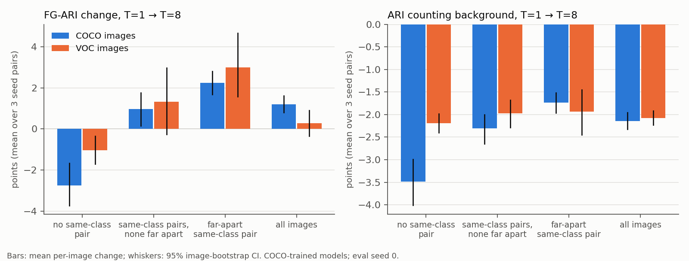
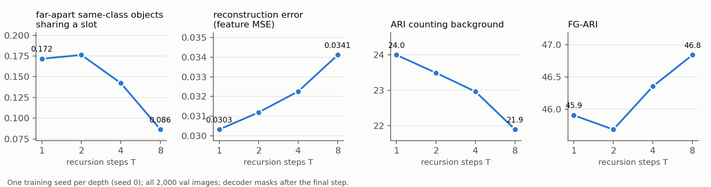
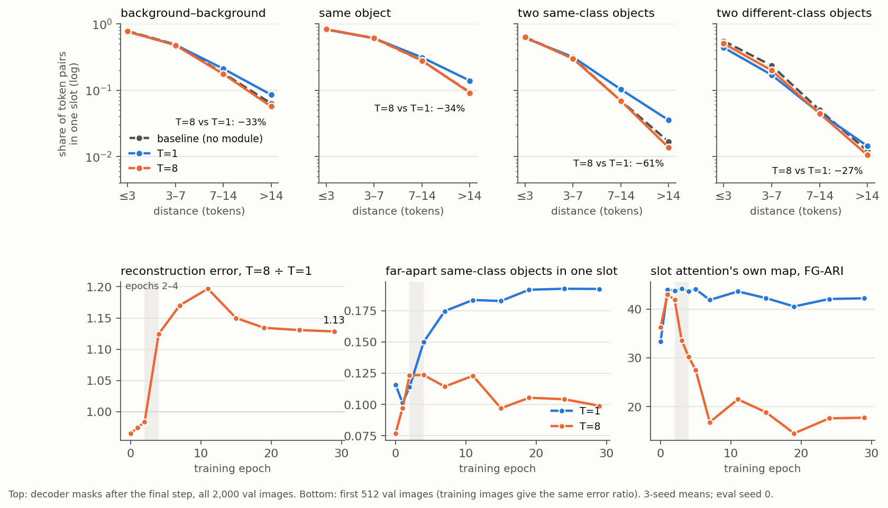
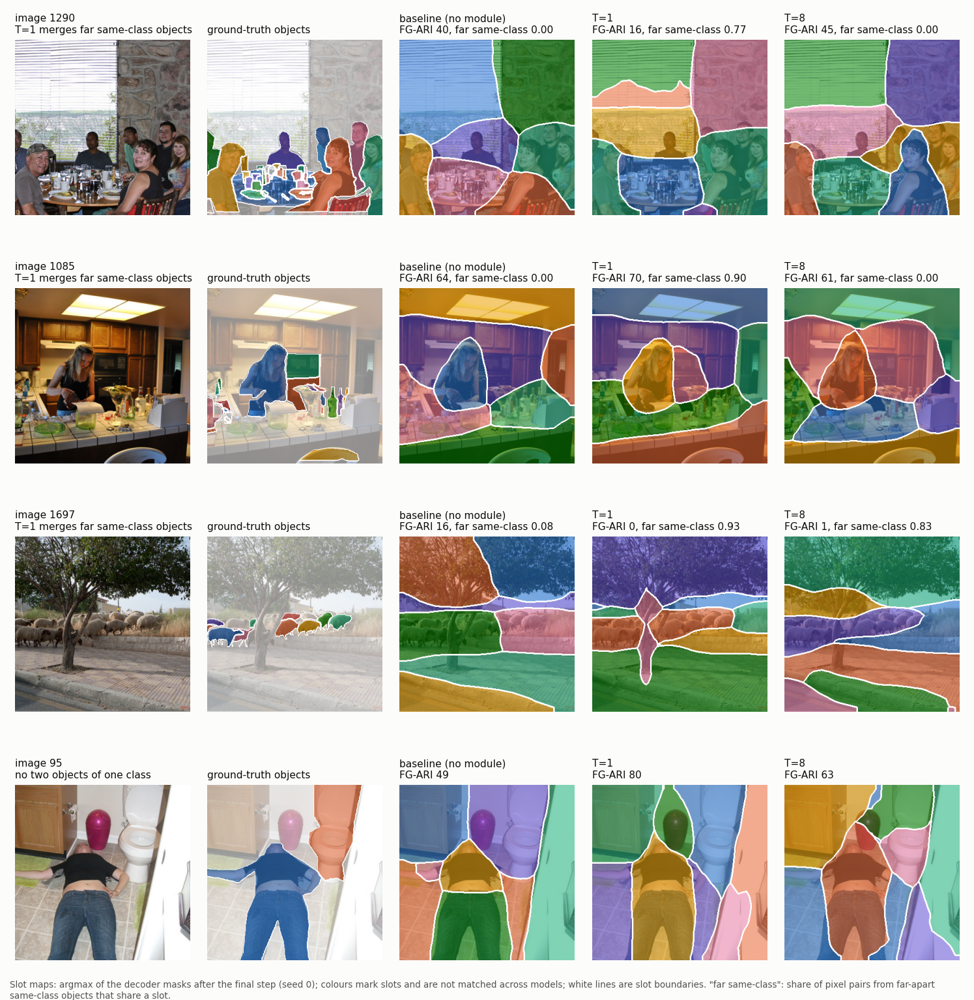
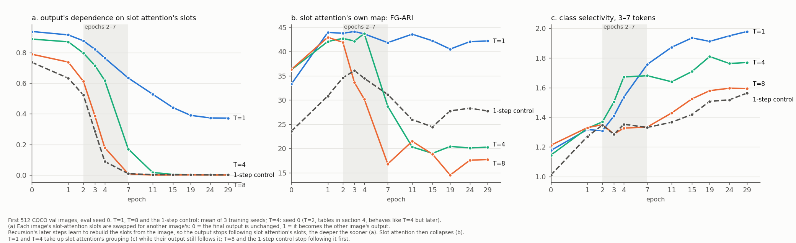
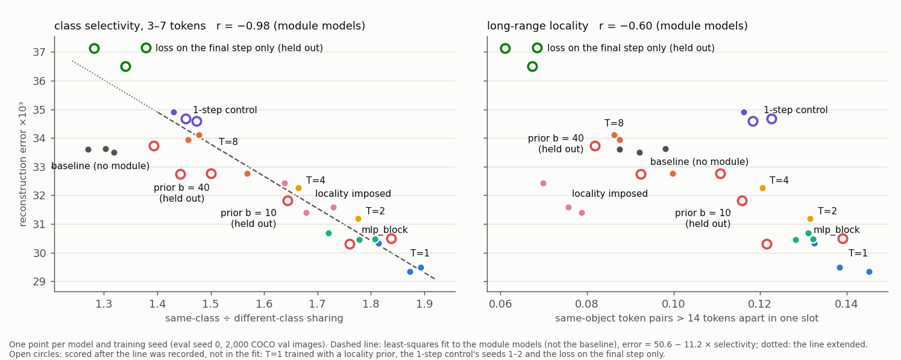

# What recursion does to the slots (T=1 → T=8)

Draft of 2026-11-03. Status of the controls (section 10):
- complete: `trm_1step` (3 seeds), the locality priors b = 10 and b = 40 (`trm_t1_lp10`, `trm_t1_lp40`, 3 seeds each), and the warm starts from the final epoch (3 seeds each);
- complete: warm starts from epochs 2 and 7 and a frozen-slot-attention rescue (the T=8 runs in 3 seeds; the T=1 runs and both learning-rate schedules in seed 0; section 10);
- complete: what starts the handover, from the saved checkpoints of every model (section 4);
- complete: `trm_final`, the loss on the final step only (3 seeds; section 10).

## Setup

- **Models.** `trm_t1` (T=1) and `trm` (T=8) on the COCO subset, 3 training seeds each. Both have the same architecture and parameters (6.40M) and the same recipe. T=8 also gets the deep-supervision losses on its 7 intermediate steps.
- **References** (3 seeds each):
  - `baseline_pm`: slot attention and decoder only, no module, parameter-matched.
  - `mlp_block`: a parameter-matched stack of the module's blocks (with cross-attention), applied once, with no recursion.
- **Data.** All 2,000 validation images. Eval seed 0 unless stated; eval seeds 1–2 replicate the main results (section 11). The learning curves use the first 512 validation images and the first 512 training images.
- **Readout.** The decoder masks after the final step, as in the eval protocol.
- **Statistics.** Differences are T=8 − T=1, averaged over the 3 matched seed pairs and then per image. CIs are 95% image-bootstrap intervals of that average. "Per seed pair" lists the three pairs separately.
- **Pixel-pair measures** (over foreground pixels):
  - *whole*: the share of an object's own pixel pairs that are in one slot.
  - *same-class sharing*: the share of pixel pairs from two different objects of the same class that are in one slot. It is split by the gap between the objects: touching ≤ 1.5 px, near ≤ 112 px, far > 112 px (7 patches).
  - *different-class sharing*: the same, for objects of different classes.
  - *background share*: the share of an object's slot that is background, averaged over object pixels.
  - *ARI counting background*: ARI over all pixels, with background as one ground-truth segment.
- **Token-pair measures.** On the 21×21 patch grid, each token takes its pixels' majority label. The measure is the share of token pairs in one slot, by type of pair and by distance (1 token = 16 px).
- **"Appearance"** means similarity of the frozen DINO features, which is largely semantic. Two regions look alike when their backbone features are close.

## Summary

**Without recursion, the module learns to group by appearance.** Far-apart regions that look alike, such as two objects of one class or two patches of the same background, end up in one slot. Neighbours that look different are kept apart.

**Trained with recursion from scratch, the module never learns that grouping.** T=8's slots group by position, much like those of the no-module baseline. In effect, recursion training acts as a locality prior: a T=1 trained with an explicit one, and no recursion, reproduces T=8's grouping and most of its costs and FG-ARI gain (point 6).

**Why: a race early in training (points 2 and 7).**
- Slot attention groups by appearance from the first epoch. The module can take that grouping up only while its output follows slot attention's slots. T=1 takes it up over epochs 2–7.
- Recursion's later steps re-read the image and learn to rebuild the slots without slot attention's. The output stops following slot attention's slots, and slot attention, no longer needed, collapses.
- At 8 steps this happens by epochs 2–4, before the module has taken up any grouping. The slots that the steps build on their own are position-based.

**Recursion does not remove appearance grouping from a model that already has it.** T=1's weights, trained on with 8 steps, keep it, and they gain FG-ARI without the costs (point 8; 3 seeds).

1. **Slot membership follows distance, not appearance.**
   - Token pairs more than 14 patches apart share a slot less often: 33% less for background, 34% less within one object, 61% less for two same-class objects.
   - Nearby tokens of different-class objects share a slot 15–17% more often.
   - All of these hold in all three seed pairs.
   - Same-class sharing ÷ different-class sharing falls at every distance, to near the baseline's level.
   - The same holds without labels. Far-apart tokens whose DINO features are similar share a slot 22–36% less often (by seed), the baseline's rate. Adjacent dissimilar tokens share one 2.2–2.4× more often.
2. **The difference is decided early in training, by a race (sections 4 and 10).**
   - **Slot attention groups by appearance by epoch 1 in every model,** with or without recursion. The outputs start without that grouping, at the no-module baseline's level.
   - **The module takes slot attention's grouping up into the slots:** T=1 over epochs 2–7. The baseline, with no module, never does.
   - **Training through several steps eventually hands the work from slot attention to the later steps.** Slot attention stops segmenting and the output decouples from it. The deeper the recursion, the earlier: T=8 at epochs 2–4, T=4 at 4–7, T=2 at 7–11.
   - **What starts the handover: the later steps learn to do without slot attention's slots.** Swapping each image's slot-attention slots for another image's moves T=8's output 0.79 of the way to that image's output at epoch 0, 0.61 at epoch 2 and 0.18 at epoch 4 (T=1: 0.94, 0.88, 0.76).
     - Slot attention collapses only after this has fallen, to 0.3 or less in the epoch it collapses, at every depth. Its training gradient then turns into large noise.
     - Without cross-attention the steps cannot re-read the image, and 8 steps leave slot attention intact. With cross-attention but no recursion (`mlp_block`), the output keeps following slot attention's slots, and it stays intact too.
   - **The takeover is what blocks the take-up; the collapse completes it.** The 1-step control stops following slot attention's slots while its slot attention still segments, and takes up no grouping (3 seeds). Freezing slot attention keeps the output following it in part (0.3–0.6) and the model stable, but it takes up little more of the grouping than without freezing (3 seeds).
   - **Grouping taken up before the handover is kept** (T=2, T=4). T=8 hands over before it has taken up any, and never recovers it.
   - From epoch 4 on, T=8's error stays 12–20% above T=1's, ending at 13%. The gap is the same on training images, so it is a worse fit, not overfitting.
   - **Warm starts confirm it** (the T=8 runs in 3 seeds, the T=1 runs in seed 0).
     - T=8's weights trained with 1 step take up part of the grouping from epoch 2, but not from epoch 7 (3 seeds; epoch 2 beats epoch 7 in every seed at every distance).
     - From T=8's epoch-2 state, 8 steps bring the handover within one or two epochs, under either learning-rate schedule. From T=1's epoch-2 state it comes five epochs later at the original learning rate, after the output has taken up the grouping, and most of the grouping survives it. Under a decaying schedule it does not come at all.
     - Freezing slot attention prevents the handover and the instability in all 3 seeds, but rescues little of the grouping. With slot attention intact, 8 steps take up less of it than 1 step from the same weights.
3. **It costs reconstruction, and every metric that counts background or class.**
   - Reconstruction error +13%, the baseline's exact level.
   - ARI counting background −2.14, mBO_c −1.86, background share +0.016.
   - The slots carry less class and size information.
   - These costs are the same in every kind of image. That fits a change in how all slots group, not just in how same-class objects are handled.
   - A T=1 trained to be local, without recursion, pays most of the same costs (point 6).
   - **What the error tracks.** Across the module's variants, error tracks class selectivity at 3–7 tokens (r = −0.98, 15 models and seeds) more closely than long-range locality (r = −0.60).
     - The fitted line predicted the three b = 10 prior runs.
     - It over-predicts all three b = 40 runs, by 1.0–1.7 (3–5 residual sd), inside its fitted range. So selectivity is not the whole story (section 5).
4. **FG-ARI rises because it penalises exactly what appearance grouping does.** Merging same-class instances lowers FG-ARI, and FG-ARI ignores background.
   - T=8's gain (+1.19 [+0.75, +1.61]) comes from images with same-class objects: +2.24 where some are far apart, against −2.75 in images with none.
   - **Locality imposed after training gives no gain (+0.11).** It does not stop T=1 merging *nearby* same-class objects, and T=8 does (near sharing −0.055).
   - **Trained in, locality does stop that merging,** and gives T=8's pattern by image group (point 6).
   - **The loss in images with no same-class pair goes with cutting objects** (T=8's whole −0.011). The 1-step control and the weak prior cut no objects and lose nothing there. The strong prior cuts nearly as many objects as T=8 and loses there too (section 10).
5. **The cause is training over several steps from scratch. Backpropagating through them adds only the long-range locality.** A control trained with TRM's 1-step gradients (3 seeds, section 10):
   - loses the class selectivity at every step, as T=8 does, and pays at least T=8's reconstruction cost;
   - is local at step 1, but its later steps drift back towards long-range grouping, ending with about a third of T=8's long-range change for background and within-object pairs;
   - has the highest FG-ARI of the decoder-read models (48.6).
   - **The losses on the intermediate steps are not the cause either; they hold the change back.** With the loss on the final step only (3 seeds), the handover comes at epoch 3 / 2 / 2 (seeds 0 / 1 / 2), no later than in T=8. The model ends more positional than T=8: class selectivity 1.28 / 1.38 / 1.34 at 3–7 tokens, against 1.48 / 1.57 / 1.46. It also cuts more objects, so its FG-ARI (44.5) is below both T=1's and T=8's (section 10).
6. **A locality prior alone reproduces the change.** T=1 was trained with a strong distance penalty on its decoder masks (b = 40), and no recursion (3 seeds, section 10). It:
   - matches T=8's token-pair profile, with and without labels: within 0.014–0.031 in every cell, by seed;
   - pays 86% of T=8's reconstruction cost and all of its mBO cost;
   - has slots that carry less class and more position information, as T=8's do;
   - gains most of T=8's FG-ARI: +0.94 [+0.50, +1.35], against T=8's +1.19 (difference −0.25 [−0.55, +0.06]);
   - shows T=8's pattern by image group: −1.7 / +0.5 / +1.8, against −2.8 / +1.0 / +2.2.
7. **Mechanism (section 3).**
   - **The decoder draws only what the slot vectors encode.** A decoder trained from scratch on frozen slots reproduces each model's grouping, locality included.
   - **The appearance grouping is made by attention over the image.** The module's cross-attention writes it into T=1's slots. Without that cross-attention, T=1 and T=8 are the same.
   - **Recursion training changes what the module writes, not what it reads.** T=8 still looks at the image by appearance, but it rebuilds the slots into position-based ones (cosine with slot attention's slots 0.45, against T=1's 0.93).
   - **Why the module ends up writing position-based slots: it never got slot attention's grouping (point 2).** Once its output no longer follows slot attention's slots, the module rebuilds the slots itself, and the slots it builds are position-based. The 8-step objective does not force this (point 8).
8. **What the model learns first decides it (warm starts, 3 seeds, section 10).** These runs continue a trained model's weights for 6 epochs with a different number of steps.
   - **T=1's weights trained with 8 steps keep their appearance grouping.** Class selectivity at 3–7 tokens is 1.78, against T=1's 1.86 and T=8's 1.50 (1.76–1.80 by seed). Far similar tokens are joined as often as in T=1.
   - **T=8's weights trained with 1 step stay positional:** class selectivity 1.48.
   - **Both solutions are stable under both objectives.** Recursion trained from scratch never finds appearance grouping. The split comes at epochs 2–4 (point 2).
   - **The 8-step warm start is the only model here that gains FG-ARI over T=1 without losing ARI counting background or mBO.** FG-ARI +1.60 [+1.21, +1.97] over T=1 and +0.41 [+0.04, +0.75] over T=8; ARI counting background 24.2, mBO_i 26.3, mBO_c 33.1, all at or above both. Its error is 4.5% above T=1's (T=8: 13%).

## 1. Slot membership follows distance, not appearance

Token pairs in one slot, by distance (3-seed means):

| pairs | model | ≤ 3 | 3–7 | 7–14 | > 14 tokens |
|---|---|---|---|---|---|
| background–background | T=1 | 0.761 | 0.482 | 0.210 | 0.085 |
| | T=8 | 0.767 | 0.475 | 0.175 | 0.057 |
| same object | T=1 | 0.820 | 0.604 | 0.311 | 0.139 |
| | T=8 | 0.827 | 0.609 | 0.279 | 0.091 |
| two same-class objects | T=1 | 0.611 | 0.316 | 0.103 | 0.035 |
| | T=8 | 0.627 | 0.298 | 0.069 | 0.014 |
| two different-class objects | T=1 | 0.437 | 0.170 | 0.045 | 0.014 |
| | T=8 | 0.503 | 0.199 | 0.045 | 0.010 |

T=8 relative to T=1, per seed pair:
- background: −17 / −13 / −20% at 7–14 tokens; −36 / −26 / −38% beyond 14;
- same object: −35 / −28 / −40% beyond 14;
- same class: −30 / −30 / −38% at 7–14; −69 / −50 / −64% beyond 14;
- different class: +16 / +11 / +18% at ≤ 3; +21 / +11 / +19% at 3–7.

**Without ground truth.** Share of token pairs in one slot, by distance and by the cosine similarity of the two tokens' DINO features (3-seed means; 2,000 images, 194M pairs):

| distance | feature cosine | baseline | T=1 | T=8 | T=8 vs T=1, per seed |
|---|---|---|---|---|---|
| > 14 tokens | > 0.7 | 0.332 | 0.452 | 0.315 | −33 / −22 / −36% |
| > 14 tokens | 0.6–0.7 | 0.134 | 0.197 | 0.121 | −42 / −31 / −43% |
| 7–14 tokens | > 0.7 | 0.412 | 0.512 | 0.424 | −18 / −12 / −21% |
| ≤ 3 tokens | > 0.7 | 0.815 | 0.817 | 0.815 | |
| ≤ 3 tokens | 0.2–0.3 | 0.238 | 0.066 | 0.149 | ×2.31 / ×2.35 / ×2.15 |

- **Far apart:** T=1 joins similar-looking tokens far more often than T=8 does, and T=8 matches the baseline.
- **Adjacent:** all three follow similarity equally, and T=8 also joins dissimilar neighbours.

How much class matters to slot sharing (same-class sharing ÷ different-class sharing):

| | ≤ 3 | 3–7 | 7–14 | > 14 tokens |
|---|---|---|---|---|
| baseline (no module) | 1.15 | 1.30 | 1.38 | 1.42 |
| `mlp_block` | 1.37 | 1.77 | 2.11 | 2.07 |
| T=1 | 1.40 | 1.86 | 2.29 | 2.50 |
| T=8 | 1.25 | 1.50 | 1.53 | 1.40 |

The same at pixel level:

| T=1 → T=8 (3 seed pairs) | T=1 | T=8 | difference [95% CI] |
|---|---|---|---|
| far same-class sharing (> 112 px) | 0.177 | 0.096 | −0.081 [−0.092, −0.071] |
| near same-class sharing (1.5–112 px) | 0.301 | 0.246 | −0.056 [−0.063, −0.047] |
| touching same-class sharing | 0.511 | 0.489 | −0.022 [−0.029, −0.014] |
| different-class sharing (all distances) | 0.110 | 0.109 | −0.002 [−0.005, 0.000] |

Different-class sharing is unchanged overall because the rise at short range and the fall at long range cancel.

**Examples.** Drawn at random by rule, seed-0 models: three of the 150 images where T=1 puts far-apart same-class objects in one slot (far sharing ≥ 0.5), and one image with no two objects of one class.

- **Images 1290 and 1085:** T=1 puts far-apart same-class objects in one slot, while T=8 and the baseline split them by position. FG-ARI follows in 1290 (16 → 45) but not in 1085 (70 → 61).
- **Image 1697:** the same-class objects form one connected band, so T=8 keeps them in one slot too (0.83).
- **Image 95:** this image has no same-class pair. T=8 cuts the person across several slots (FG-ARI 80 → 63).

**What the slots encode.** Linear probes on each object's best-IoU slot:
- 13,675 objects;
- the class probe covers 66 classes, where always guessing the majority class scores 0.31;
- 5-fold CV, grouped by image;
- each cell gives the 3-seed mean, then the three seeds.

| | class accuracy | position R² | size R² |
|---|---|---|---|
| T=1 | 0.639 (0.638 / 0.638 / 0.640) | 0.678 (0.671 / 0.682 / 0.682) | 0.431 |
| T=8 | 0.616 (0.615 / 0.622 / 0.610) | 0.726 (0.738 / 0.713 / 0.728) | 0.387 |
| `mlp_block` | 0.636 | 0.693 | 0.431 |

The seed ranges of T=1 and T=8 don't overlap on any probe. Split by whether the object's class appears elsewhere in the image (T=8 − T=1, 3 seed pairs):

| objects | n | class accuracy | position R² | size R² |
|---|---|---|---|---|
| only one of its class | 3,359 | −0.021 [−0.030, −0.011] | +0.019 [+0.009, +0.030] | −0.042 [−0.055, −0.030] |
| has a same-class object | 10,316 | −0.024 [−0.031, −0.017] | +0.056 [+0.050, +0.063] | −0.047 [−0.058, −0.039] |

- The position gain is three times larger where there are same-class objects to tell apart.
- The class and size losses are the same for objects that are the only one of their class. Slots that group by position also take in more of the nearby objects of other classes (above), which fits a uniform loss of class information. That link is not tested directly.

## 2. Recursion removes what the module adds

| decoder masks, 3 seeds | FG-ARI | ARI counting background | mBO_i | mBO_c | whole | far same-class | near same-class | different-class | background share | MSE ×10³ |
|---|---|---|---|---|---|---|---|---|---|---|
| baseline (no module) | 43.9 | 21.6 | 23.4 | 29.0 | 0.611 | 0.114 | 0.262 | 0.124 | 0.447 | 33.6 |
| `mlp_block` | 45.1 | 23.8 | 25.2 | 32.2 | 0.635 | 0.175 | 0.304 | 0.114 | 0.418 | 30.5 |
| T=1 | 45.8 | 24.1 | 25.7 | 32.9 | 0.641 | 0.177 | 0.301 | 0.110 | 0.413 | 29.7 |
| T=8 | 47.0 | 22.0 | 25.2 | 31.1 | 0.631 | 0.096 | 0.246 | 0.109 | 0.428 | 33.6 |

- **The module used once** (T=1 or `mlp_block`) adds long-range appearance grouping to the baseline: far same-class sharing 0.114 → 0.177, and class matters more to slot sharing at every distance. With it come:
  - 12% lower reconstruction error;
  - less background in each object's slot;
  - higher ARI counting background and mBO.
- **T=8 removes the long-range grouping.** Far same-class sharing falls even below the baseline's, and the reconstruction gain is given back exactly.
- **It keeps the module's object-level gains over the baseline:** objects more whole (0.631 against 0.611) and fewer different-class merges (0.109 against 0.124).

## 3. Where the locality comes from

It comes from training with recursion, not from the module itself or from iterating it.
- **Dose-response** (seed 0), T=1 / T=2 / T=4 / T=8:
  - far same-class sharing 0.172 / 0.176 / 0.142 / 0.086;
  - reconstruction error 0.0303 / 0.0312 / 0.0323 / 0.0341.
- **`mlp_block`**, the same kind of blocks with cross-attention applied once (3 seeds), is not local: far sharing 0.175.
- **Running the T=1 model for more steps at test time** doesn't make it local. Its masks collapse onto a few slots instead: at 8 steps, far sharing is 0.54, different-class sharing 0.54, FG-ARI 15.1 and reconstruction error 0.29. The T=8 model run for 16 steps is stable (FG-ARI 47.0, error 0.034).
- **Training makes the iteration converge.**
  - Iterating the T=1 module is unstable: after 8 steps only 3.9 of the 7 slots still own a patch.
  - The trained T=8 module keeps all 7 slots for 16 steps. Each slot's mask centroid stops moving: 1.41 patches per step at step 2, 0.10 at step 8, 0.04 at step 16.
  - T=1's iterated masks do not merge by appearance; they merge indiscriminately. By step 2, same-class ÷ different-class sharing falls from 1.40–2.46 to 1.09–1.25 at every distance, and by step 8 to 1.01–1.14. The T=8 module run to 16 steps keeps its profile unchanged (3 seeds each).
  - The slot vectors themselves drift apart rather than converge: the mean cosine between slots goes from 0.80 to 0.29 over 8 steps. Iterating T=1 takes its slots off the distribution its decoder was trained on.
- **Inside a trained T=8, the output is local from step 1** (far sharing 0.110).
  - Step 1's cross-attention is as broad as T=1's: about 185 effective patches against 203, and a spatial sd of 6.2 against 6.3 patches.
  - Later steps narrow it to 134 effective patches and repair the objects: whole 0.580 → 0.631, FG-ARI 40.8 → 47.0.
  - So the locality is in the trained weights, not in narrower reads at inference.
  - With 1-step gradients, step 1 is just as local, but the later steps lose part of it (section 10).

**How the module makes appearance grouping, and what recursion changes in it.**

1. **The decoder draws only what the slot vectors encode.**
   - It sees each slot vector plus a position embedding, never the image.
   - A decoder trained from scratch on a model's frozen final slots (4 epochs, same loss) reproduces that model's grouping:
     - T=1's appearance grouping: class selectivity 1.75 / 2.11 at 3–7 / 7–14 tokens, against 1.81 / 2.19 with its own decoder;
     - T=8's locality: same-object sharing beyond 14 tokens 0.085, against 0.086.
   - Both fresh decoders reconstruct worse than the originals (34.2 and 37.3, against 30.3 and 34.1), yet the grouping does not change.
   - So the grouping, locality included, is in the slots.
2. **Attention over the image groups by appearance, and the module's cross-attention writes that grouping into the slots.**

| 3 seeds | class selectivity, 3–7 / 7–14 tokens | dissimilar neighbours joined | far similar tokens joined |
|---|---|---|---|
| baseline: slot attention's own map | 1.78 / 2.11 | 0.017 | 0.411 |
| baseline: decoder output | 1.30 / 1.38 | 0.238 | 0.332 |
| T=1: slot attention's own map | 2.24 / 2.91 | 0.022 | 0.503 |
| T=1: decoder output | 1.86 / 2.27 | 0.066 | 0.452 |
| T=8: slot attention's own map (collapsed) | 1.20 / 1.25 | 0.415 | 0.605 |
| T=8: decoder output | 1.50 / 1.55 | 0.149 | 0.315 |

   - **Slot attention groups by appearance, but without the module the decoder loses most of it.** Slot attention's own map, which sees the image, groups strongly by appearance. The baseline's masks join dissimilar neighbours 14 times as often as its slot-attention map does.
   - **T=1 keeps that grouping.** It keeps slot attention's slots (cosine 0.93 between its output and input slots) and adds what its cross-attention reads, so its masks keep most of the grouping.
   - **Models trained without the module's cross-attention show this directly.** VOC-trained, single seed, scored on the COCO images:

| | far similar tokens joined | dissimilar neighbours joined | class selectivity, 3–7 / 7–14 | error ×10³ |
|---|---|---|---|---|
| T=1, no cross-attention | 0.375 | 0.182 | 1.29 / 1.32 | 36.7 |
| T=8, no cross-attention | 0.393 | 0.181 | 1.30 / 1.30 | 36.6 |
| T=1, cross-attention | 0.417 | 0.104 | 1.74 / 2.10 | 34.4 |
| T=8, cross-attention | 0.377 | 0.156 | 1.53 / 1.69 | 36.6 |

   - Without cross-attention, T=1 and T=8 are the same and group like the baseline, so recursion has nothing to remove.
   - With it, T=1 groups by appearance and reconstructs better. T=8 loses most of both: its error returns to the no-cross-attention level.

3. **Recursion changes what the module writes, not what it reads.**
   - **Reads.** Each slot's cross-attention over the 441 patches was regressed on two standardised predictors:
     - a patch's DINO-feature similarity to what the slot reads;
     - its squared distance from the slot's read centroid.

| reads | appearance coefficient | position coefficient |
|---|---|---|
| T=1 | 0.73–0.77 | 0.16–0.20 |
| T=8, step 1 | 0.68–0.72 | 0.20–0.25 |
| T=8, step 8 | 0.74–0.75 | 0.20–0.22 |

     - The ranges are the three seeds.
     - T=8 looks at the image by appearance, as T=1 does.
   - **Writes.** T=8 rebuilds the slots rather than adjusting them.
     - Its slots' cosine with slot attention's slots is 0.70 after step 1 and 0.45 after step 8, against T=1's 0.93.
     - Each cross-attention update is smaller, about 0.5 of the slot state against T=1's 0.9–1.3, but there are 8 steps of them.
     - **Update size is not the cause.** The 1-step control (seed 0; these attention measures were not repeated for seeds 1 and 2) is the test.
       - It writes as strongly as T=1: its largest cross-attention update is 1.3–1.6 of the slot state at step 1.
       - It reads by appearance (coefficients 0.63 / 0.26) and also rebuilds the slots (cosine 0.64).
       - It loses class selectivity as fully as T=8.
       - So T=8's weaker updates come with backpropagating through the steps, not with losing the grouping.
   - **The slots it builds are position-based.** They carry more position and less class information (section 1), and a fresh decoder draws them as local masks (point 1).

By depth (seed 0):

| | T=1 | T=2 | T=4 | T=8 |
|---|---|---|---|---|
| slot attention's map: largest slot | 0.31 | 0.39 | 0.58 | 0.82 |
| cosine of final slots with slot attention's | 0.93 | 0.73 | 0.40 | 0.46 |
| class selectivity, 3–7 tokens | 1.81 | 1.78 | 1.66 | 1.48 |
| same object, > 14 tokens | 0.133 | 0.132 | 0.120 | 0.086 |

Already at T=2 slot attention starts to collapse and the module rebuilds the slots, yet the grouping stays appearance-based. It turns positional only with more steps.

**Ruled out as the reason:**
- **The module reading by position:** its reads stay appearance-driven.
- **Slots that read the same patches merging when iterated:** T=1's iterated slot vectors drift apart instead.
- **Slot-attention collapse by itself:** T=2, T=4 and the 8-step warm start collapse without becoming local. But all three collapse after their module has learned appearance grouping (section 4).
- **A shrinking slot initialisation:** the spread of slot attention's learned initial slots is unchanged in every model (σ 0.96–0.98 per dimension, all epochs).
- **Weaker writes:** the 1-step control writes as strongly as T=1, and it loses class selectivity all the same.
- **Slots needing position as their only identity:**
  - Slot attention's slots are nearly identical in every model with a module (mean pairwise cosine 0.88–0.91, against 0.53 in the baseline), T=1 included.
  - The module creates the differences between slots in T=1 as much as in T=8.

**Not forced by the objective: two stable solutions (warm starts, section 10).**
- **An 8-step module keeps an appearance layout when it starts from one.** T=1's weights, trained 6 more epochs with 8 steps, keep T=1's grouping and improve on it. So the idea that an appearance layout cannot survive repeated application is ruled out.
- **A 1-step objective does not bring the grouping back.** T=8's weights trained with 1 step stay positional.
- **So the positional solution is where recursion training from scratch goes, not something the 8-step objective demands.** The split happens early. At epochs 2–4, T=1 starts merging far same-class objects while T=8's error stalls and its slot attention collapses (section 4).
- **Once taken up, the grouping no longer needs slot attention.** In the 8-step warm start, slot attention's map loses its grouping in the first epoch (selectivity 2.39 → 1.19, FG-ARI 42 → 25, largest slot 0.46). The output keeps it (1.69 → 1.83 over the 6 epochs, first 512 images).
- **With 1 step, T=8's slot attention does not regain its grouping** (selectivity 1.18 → 1.31, FG-ARI 11 → 19 over the 6 epochs). So there is nothing for the module to take up, and the output stays positional.
- **Why the from-scratch path goes positional: a race (sections 4 and 10).**
  - Every multi-step model hands the work from slot attention to the later steps, and the deeper the recursion, the earlier.
  - It starts when the later steps, which re-read the image through cross-attention, learn to rebuild the slots without slot attention's. The output stops depending on slot attention's slots, and slot attention collapses after (section 4).
  - Grouping taken up before the handover is kept. T=8 hands over at epochs 2–4, before it has taken up any.
  - The warm starts confirm the timing (free at epoch 2, committed by epoch 7; 3 seeds). The handover comes much sooner from T=8's early state than from T=1's, under either learning-rate schedule. Freezing slot attention prevents it, but rescues little of the grouping.
  - The losses on the intermediate steps are not needed: with the loss on the final step only (`trm_final`, seeds 0 / 1 / 2), the handover comes at epoch 3 / 2 / 2, no later than in T=8 (section 10).

## 4. When it happens in training

Learning curves, 3 seeds (512 validation and 512 training images; error ×10³):

| epoch | val error T=1 | val error T=8 | T=8 / T=1 (val) | T=8 / T=1 (train) | far same-class T=1 | far same-class T=8 | slot-attention map FG-ARI T=1 | slot-attention map FG-ARI T=8 |
|---|---|---|---|---|---|---|---|---|
| 0 | 59.9 | 57.9 | 0.97 | 0.97 | 0.116 | 0.077 | 33.3 | 36.3 |
| 2 | 45.0 | 44.3 | 0.98 | 0.98 | 0.114 | 0.123 | 43.8 | 41.9 |
| 4 | 40.6 | 45.7 | 1.12 | 1.13 | 0.150 | 0.124 | 43.7 | 30.2 |
| 7 | 36.9 | 43.2 | 1.17 | 1.18 | 0.175 | 0.114 | 41.9 | 16.8 |
| 11 | 34.1 | 40.8 | 1.20 | 1.20 | 0.183 | 0.123 | 43.6 | 21.5 |
| 19 | 31.5 | 35.7 | 1.13 | 1.13 | 0.192 | 0.105 | 40.5 | 14.5 |
| 29 | 29.9 | 33.7 | 1.13 | 1.13 | 0.192 | 0.099 | 42.2 | 17.7 |

- **T=8 is ahead for the first 2 epochs.** At epoch 2 both rarely put far same-class objects in one slot.
- **Epochs 2–4 are where they part.** T=1 starts merging far same-class objects, and its error keeps falling. T=8's error stops falling (44.3 → 45.7), and it never learns to merge them.
- **It is a fit gap, not overfitting:** the ratio is the same on training images.
- **The gap is not closing:** the ratio has been 1.13 since epoch 19, and the schedule's learning rate is near zero by the end.
- **T=8's slot attention stops segmenting in the same window, in all 3 seeds.**
  - Its map's FG-ARI falls from 41.9 at epoch 2 to 16.8 at epoch 7.
  - The largest slot grows from 0.28 to 0.60 of the image, and slots in use fall from 7 to 4.5.
  - T=1's map stays at 40–44 FG-ARI with a largest slot of about 0.3.
- **The collapse is not needed for the gap.** In the 1-step-gradient control, the error gap is open by epoch 4 while its slot attention still segments (FG-ARI 37.0 / 35.5 / 31.0, largest slot 0.35–0.37, seeds 0 / 1 / 2). Its slot attention later collapses only gradually and partly (FG-ARI 26–32 and largest slot 0.39–0.44 at the end), yet its final error is at least T=8's (section 10).

**Slot attention groups by appearance from the first epoch, and the output has to learn to take it up.** Class selectivity at 3–7 tokens of slot attention's own map and of the output, by epoch (first 512 validation images, where it runs about 0.1 above the full set; baseline and `mlp_block` seed 0):

| epoch | 0 | 1 | 2 | 3 | 4 | 7 | 11 | 29 |
|---|---|---|---|---|---|---|---|---|
| T=1: slot attention | 1.68 | 1.80 | 1.79 | 1.93 | 2.04 | 2.18 | 2.40 | 2.39 |
| T=1: output | 1.18 | 1.32 | 1.31 | 1.41 | 1.54 | 1.76 | 1.87 | 1.98 |
| T=8: slot attention | 1.49 | 1.81 | 1.73 | 1.53 | 1.36 | 1.30 | 1.41 | 1.22 |
| T=8: output | 1.21 | 1.33 | 1.35 | 1.29 | 1.33 | 1.33 | 1.43 | 1.59 |
| baseline: slot attention | 1.51 | 1.56 | 1.84 | 1.81 | 1.79 | 1.85 | 1.82 | 1.89 |
| baseline: output | 1.16 | 1.23 | 1.35 | 1.32 | 1.28 | 1.28 | 1.32 | 1.32 |
| `mlp_block`: output | 1.21 | 1.26 | 1.40 | 1.35 | 1.37 | 1.63 | 1.63 | 1.88 |

- **Every model's slot attention groups by appearance by epoch 1** (1.7–2.3 at epochs 1–2, T=2, T=4 and the 1-step control included). Every output starts near the baseline decoder's level, about 1.3.
- **Taking the grouping up needs the module.** T=1's output does it over epochs 2–7 and `mlp_block`'s over epochs 4–7. The baseline's decoder never does.
- **T=8's slot attention loses its grouping (epochs 3–4) before T=8's output has taken any of it up.**
- **Until then every output follows its slot attention.** The agreement between slot attention's map and the output is about 0.6 ARI in every model, T=1's level throughout training. Then the multi-step outputs decouple: T=8 seed 0 goes from 0.60 at epoch 2 to 0.34 at epoch 3 and 0.07 at the end.

**Learned before or after the handover.** Class selectivity of the output at 3–7 tokens by depth:

| epoch | 0 | 1 | 2 | 3 | 4 | 7 | 11 | 29 |
|---|---|---|---|---|---|---|---|---|
| T=1 (3 seeds) | 1.18 | 1.32 | 1.31 | 1.41 | 1.54 | 1.76 | 1.87 | 1.98 |
| T=2 (seed 0) | 1.16 | 1.31 | 1.31 | 1.45 | 1.59 | 1.73 | 1.64 | 1.89 |
| T=4 (seed 0) | 1.14 | 1.33 | 1.37 | 1.50 | 1.67 | 1.68 | 1.64 | 1.77 |
| T=8 (3 seeds) | 1.21 | 1.33 | 1.35 | 1.29 | 1.33 | 1.33 | 1.43 | 1.59 |
| 1-step control (3 seeds) | 1.01 | 1.27 | 1.35 | 1.28 | 1.35 | 1.33 | 1.37 | 1.56 |
| T=8, loss on the final step only (3 seeds) | 1.21 | 1.30 | 1.19 | 1.14 | 1.18 | 1.26 | 1.28 | 1.39 |

- **T=8 does not lose class selectivity; it never gains it.** All models are level through epoch 2. T=1, T=2 and T=4 gain it over epochs 2–7. T=8 and the 1-step control stay flat until epoch 11.
- **Every multi-step model goes through a handover.** Slot attention stops segmenting, the step-1 output gets worse, and the later steps take over the reconstruction. The deeper the recursion, the earlier it comes:

| | handover (slot attention map FG-ARI) | step-1 minus final error ×10³, before → after | selectivity at the handover |
|---|---|---|---|
| T=2 | epochs 7–11 (40 → 26) | +0.8 → +3.2 | 1.73: already learned |
| T=4 | epochs 4–7 (44 → 29) | +0.7 → +4.8 | 1.67: already learned |
| T=8, seeds 0 / 1 / 2 | epochs 2–4 (43 / 44 / 39 → 30 / 32 / 29) | +0.8 / +0.8 / +1.2 → +9.0 / +3.4 / +6.0 | 1.32 / 1.34 / 1.40: not yet |
| 1-step control, seeds 0 / 1 / 2 | epochs 4–11, gradual (37 / 35 / 31 → 22 / 30 / 26) | +1.4 / +1.5 / +1.5 → +2.8 / +2.5 / +2.2 | 1.32 / 1.39 / 1.35: not yet |
| T=8, loss on the final step only, seeds 0 / 1 / 2 | epochs 2–3 / 1–2 / 1–2, abrupt (42 / 40 / 43 → 22 / 19 / 21) | — (intermediate steps not trained to reconstruct) | 1.27 / 1.34 / 1.29: not yet |
| T=1 weights → 8 steps | first epoch (largest slot 0.46) | +5.9 | 1.69: already learned |

- **In T=8 seed 0 the handover is abrupt.** Step 1's error jumps from 45.4 to 58.7 between epochs 2 and 4, worse than at epoch 0, and the final step's from 44.6 to 49.6.
- **Grouping learned before the handover is kept; grouping not yet learned is not learned afterwards.** T=2, T=4 and the 8-step warm start keep their selectivity through the handover. T=8 and the 1-step control reach it before learning any, and stay positional.
- **The 1-step control learns more slowly.** Its slot attention still segments at epochs 2–4 (map FG-ARI 31–38), but its error is far behind (49.5 / 48.7 / 49.2 at epoch 4 in seeds 0 / 1 / 2, against T=1's 40.7 / 40.5 / 40.6). In all three seeds it reaches the error at which T=1 starts gaining selectivity (about 42, epoch 3) only at epochs 7–11, just as its slot attention collapses.
- **Within T=8 the order holds too.** Seed 1 has the latest handover (map FG-ARI still 41 at epoch 3), had gained the most selectivity by then (1.43), and ends with the highest selectivity of the three seeds (1.57 against 1.48 and 1.46 on the full set).
- **The share of the loss on step 1 falls with depth** (100% at T=1, 20% at T=2, 14% at T=4, 9% at T=8), but that is not what times the handover. With no loss on the intermediate steps (`trm_final`), it comes at epoch 3 / 2 / 2 (seeds 0 / 1 / 2), no later than in T=8.

**What starts the handover: the later steps learn to do without slot attention's slots.**
- The test swaps each image's slot-attention slots for another image's and scores the final output against the image's own features.
  - 0 means the output is unchanged: it ignores slot attention's slots.
  - 1 means it becomes the other image's output: it follows them completely.
- The table shows this dependence (first 512 validation images; T=2, T=4, `mlp_block` and VOC seed 0, the others 3 seeds):

| epoch | 0 | 1 | 2 | 3 | 4 | 5 | 7 | 11 | 29 |
|---|---|---|---|---|---|---|---|---|---|
| T=1 (3 seeds) | 0.94 | 0.92 | 0.88 | 0.82 | 0.76 | 0.72 | 0.63 | 0.53 | 0.37 |
| T=2 | 0.91 | 0.89 | 0.84 | 0.78 | 0.71 | 0.65 | 0.53 | 0.20 | 0.06 |
| T=4 | 0.89 | 0.87 | 0.80 | 0.72 | 0.62 | 0.53 | 0.17 | 0.02 | 0.00 |
| T=8 (3 seeds) | 0.79 | 0.74 | 0.61 | 0.39 | 0.18 | 0.07 | 0.01 | 0.00 | 0.00 |
| T=8, loss on the final step only (3 seeds) | 0.58 | 0.43 | 0.13 | 0.01 | 0.00 | 0.00 | 0.00 | 0.00 | 0.00 |
| 1-step control (3 seeds) | 0.74 | 0.63 | 0.52 | 0.29 | 0.09 | 0.04 | 0.01 | 0.00 | 0.00 |
| `mlp_block` (no recursion) | 0.97 | 0.96 | 0.96 | 0.94 | 0.92 | 0.90 | 0.85 | 0.79 | 0.69 |
| VOC T=8 with cross-attention | 0.72 | 0.76 | 0.73 | 0.68 | 0.60 | 0.53 | 0.31 | 0.08 | 0.03 |
| VOC T=8 without cross-attention | 1.00 | 1.00 | 1.00 | 1.00 | 1.00 | 1.00 | 1.00 | 1.00 | 1.00 |

- **The output stops following slot attention's slots before slot attention collapses, at every depth.**
  - Slot attention's slot concentration (Σ share², 1/7 when even) stays at 0.18–0.21 until the dependence has fallen (VOC's epoch 0: 0.25).
  - In the epoch it starts to rise, the dependence is 0.29 / 0.31 / 0.30 for T=8 (seeds 0 / 1 / 2; epochs 3 / 4 / 3), 0.17 for T=4 (epoch 7), 0.20 for T=2 (epoch 11), 0.02 / 0.03 / 0.01 for the final-step-loss model (seeds 0 / 1 / 2; epochs 3 / 2 / 2) and 0.31 for VOC T=8 (epoch 7).
  - In the saved epoch before, it is 0.34–0.59.
  - The deeper the recursion, the sooner: T=8 is at 0.61 by epoch 2, a level T=1 reaches only at epoch 7.
- **Each step keeps only part of slot attention's slots, and the losses compound over the steps.** At T=8's epoch 2, the dependence is 0.79–0.85 after step 1 and 0.57–0.67 after step 8 (by seed). Training lowers it at every step.
- **When the output no longer follows them, slot attention's training gradient turns into noise.** Gradients are measured on 256 training images, in 32 batches of 8.
  - In the epoch it collapses, T=8's slot-attention gradient is 2–27× larger than in the epoch before (by seed). Its coherence across batches, the average agreement between batch gradients, falls from 0.03–0.20 to about zero (at most 0.006).
  - T=2, T=4, the final-step-loss model and VOC T=8 do the same.
  - In T=1, `mlp_block` and VOC T=8 without cross-attention, the gradient stays small and coherent (0.01–0.26 after epoch 0) through epoch 11, and slot attention never collapses.
  - Late in training, T=1's dependence falls to 0.37 and its gradient loses coherence too. But the gradient stays small, the learning rate is low by then, and slot attention stays intact.
- **Cross-attention lets the steps do without slot attention's slots, and recursion makes them do it.**
  - A T=8 without cross-attention (VOC-trained) sees the image only through slot attention's slots. Its slot attention never collapses, although it is trained through 8 steps with full backpropagation and the same losses.
  - `mlp_block` has the same cross-attention in 3 stacked blocks applied once. Its output keeps following slot attention's slots (0.69 at the end), and its slot attention never collapses.
- **The takeover blocks the take-up; the collapse completes it.**
  - In seed 0, the 1-step control's output stops following slot attention's slots as fast as T=8's (0.12 at epoch 4) while its slot attention still segments (map FG-ARI 37–38 at epochs 3–4). It takes up no grouping.
  - Seed 1 of the 1-step control does the same.
    - Its dependence goes 0.56 / 0.32 / 0.10 at epochs 2 / 3 / 4.
    - Meanwhile slot attention's map still groups by appearance: selectivity 2.16 / 2.07 / 1.94, FG-ARI 34–36.
    - From epoch 1 to epoch 11 the output stays at 1.26–1.39. On the full set it ends at 1.45 at 3–7 tokens, against 1.57 for T=8 of seed 1 (section 10).
    - Its slot attention then collapses gradually and only partly, as in seed 0: map FG-ARI 33 at epoch 7 and 26 at the end, largest slot 0.42.
  - Seed 2 does the same, and sooner.
    - Its dependence goes 0.44 / 0.18 / 0.05 at epochs 2 / 3 / 4.
    - Meanwhile slot attention's map still groups by appearance: selectivity 2.04 / 1.99 / 1.96, FG-ARI 31–35, largest slot 0.34–0.37.
    - The output reaches 1.43 at epoch 2, while it still follows slot attention's slots. As the dependence falls it stays at 1.27–1.44 over epochs 3–11. On the full set it ends at 1.47 at 3–7 tokens, level with T=8 of seed 2 (1.46).
    - Slot attention's map loses its grouping between epochs 5 and 7 (selectivity 1.92 → 1.38) and collapses only partly (FG-ARI 26–32 from epoch 11, largest slot 0.37–0.42).
    - Late in training the map regroups (selectivity 1.33 at epoch 11, 1.85 at the end), while the output still ignores its slots (dependence 0).
  - The gradient reaching its slot-attention slots is about 10× smaller than T=8's (seed 0). Its slot attention collapses only gradually, over epochs 4–11, and only partly.
- **The warm starts fit the same account** (section 10):
  - With slot attention frozen at T=8's epoch 2, the dependence stays at 0.33–0.59 over the 6 epochs, against 0.00–0.01 at the end unfrozen (3 seeds). Far same-class sharing ends only a little higher (0.123 against 0.118; section 10).
  - T=8's epoch-2 weights trained with 1 step stay at 0.51–0.69 and take up the grouping.
  - From T=1's epoch-2 weights, 8 steps at the original learning rate bring the dependence down from 0.76 to 0.43, and slot attention starts to collapse in the sixth epoch (concentration 0.22). Under the decaying schedule the dependence levels off at 0.59 and nothing collapses.
  - T=1's final weights trained with 8 steps drop to 0.09 in the first epoch, and slot attention collapses at once (concentration 0.32). The output keeps its grouping, because by then the module itself has learned it.

- **Warm starts from epochs 2 and 7 test this causally (section 10).**
  - T=8's weights are not committed at epoch 2 (1 step from there takes up part of the grouping) and are by epoch 7 (3 seeds).
  - From T=8's epoch-2 state the handover comes within one or two epochs, under either schedule. From T=1's it comes five epochs later at the original learning rate, after the take-up, and not at all under a decaying schedule.
  - Freezing slot attention prevents it (3 seeds), but rescues little of the grouping. With slot attention intact, 8 steps take up less of it than 1 step from the same weights.

## 5. What it costs

| T=1 → T=8 | T=1 | T=8 | difference [95% CI] |
|---|---|---|---|
| reconstruction error (feature MSE) | 0.0297 | 0.0336 | +13% (per seed pair +12.5%, +11.2%, +15.7%) |
| ARI counting background | 24.1 | 22.0 | −2.14 [−2.32, −1.97] |
| mBO_c | 32.9 | 31.1 | −1.86 [−2.07, −1.64] |
| background share of an object's slot | 0.413 | 0.428 | +0.016 [+0.014, +0.018] |
| whole | 0.641 | 0.631 | −0.011 [−0.015, −0.007] |

**The costs are the same everywhere.**
- Reconstruction error by image group:
  - no same-class pair: +14.5%;
  - same-class pairs, none far apart: +13.6%;
  - a far same-class pair: +12.4%.
- Per patch: background +13.5%, object interiors +13.7%, edges +12.0%.
- The class and size probes lose the same for objects that are the only one of their class (section 1).

**Locality imposed by hand costs in the same way.**
- Method:
  - T=1's decoder reconstructs Σ_k softmax_k(α_k) f_k.
  - b·d_k² is subtracted from each slot's logit α_k. Here d_k is the distance, in image widths, from the patch to the centroid of the slot's largest connected piece.
  - The f_k are kept as trained, and there is no retraining.
- With b = 10, far same-class sharing matches T=8's exactly. b = 5 and b = 20 cost +2.9% and +14.7% in reconstruction.

| 3 seeds | far same-class | near same-class | whole | background share | ARI counting background | mBO_c | reconstruction vs T=1 | FG-ARI vs T=1 |
|---|---|---|---|---|---|---|---|---|
| T=1 | 0.177 | 0.301 | 0.641 | 0.413 | 24.1 | 32.9 | | |
| T=1 with locality imposed (b = 10) | 0.096 | 0.295 | 0.639 | 0.426 | 22.1 | 31.4 | +7.0% | +0.11 |
| T=8 | 0.096 | 0.246 | 0.631 | 0.428 | 22.0 | 31.1 | +13.1% | +1.19 |

- **What imposed locality reproduces:**
  - T=8's background share, ARI counting background and mBO_c;
  - T=8's token profile for background, same-object and different-class pairs. For example, different-class sharing at ≤ 3 tokens is 0.494 against T=8's 0.503.
- **Its reconstruction cost is just as uniform:** +7.3 / +7.4 / +6.8% across the three image groups. So uniformity cannot separate "locality" from a second, independent effect.
- **It accounts for about half of T=8's reconstruction loss.** Two things are left unexplained: the other half, and T=8's extra object cutting (whole −0.011 against −0.002). A penalty imposed after training is only a stand-in for a trained local model. A T=1 trained with a strong locality prior pays 86% of the cost (section 10).

**What the reconstruction cost follows.** Six variants of the module, seed 0: trained with 1, 2, 4 and 8 steps, T=1 with locality imposed, and the 1-step-gradient control (section 10).

| seed 0 | class selectivity, 3–7 tokens | class selectivity, 7–14 tokens | far same-class sharing | far similar tokens joined | error ×10³ |
|---|---|---|---|---|---|
| T=1 | 1.81 | 2.19 | 0.172 | 0.454 | 30.3 |
| T=2 | 1.78 | 2.13 | 0.176 | 0.448 | 31.2 |
| T=4 | 1.66 | 1.90 | 0.142 | 0.417 | 32.3 |
| T=1 with locality imposed (b = 10) | 1.64 | 1.95 | 0.094 | 0.267 | 32.4 |
| T=8 | 1.48 | 1.51 | 0.086 | 0.303 | 34.1 |
| 1-step control | 1.43 | 1.43 | 0.129 | 0.396 | 34.9 |
| correlation with error | −0.99 | −0.99 | −0.69 | −0.49 | |

Class selectivity is same-class ÷ different-class sharing of token pairs at that distance. "Far similar tokens joined" is the share of token pairs more than 14 tokens apart, with feature cosine above 0.7, that share a slot.

- **Error rises in the same order as class selectivity at 3–7 tokens falls, in all six.**
- **It does not follow long-range locality.** Imposed locality is as local as T=8, or more, but pays about half the cost. The 1-step control keeps much of T=1's long-range grouping but pays all of it.
- **This explains the imposed-locality result above:** it removes about half the selectivity.
- **A plausible reason:** a slot that mixes classes has to reconstruct unlike features from one vector.
- **It holds across seeds.** All 15 module models and seeds: T=1, T=8, imposed locality and `mlp_block` with 3 seeds each, and T=2, T=4 and the 1-step control with 1.
  - r = −0.98 at 3–7 tokens and −0.93 at 7–14 tokens, against −0.60 for long-range same-object sharing.
  - Fitted line: error = 50.6 − 11.2 × selectivity at 3–7 tokens, residual sd 0.34.
  - The no-module baseline lies off this line, with lower error for its selectivity (33.6 against a predicted 36.0). It is a different architecture.
- **Out-of-sample check.** The line was recorded before the locality-prior runs (section 10) were scored.
  - Prior b = 10, seeds 0 / 1 / 2 (selectivity 1.64 / 1.84 / 1.76): predicted 32.2 / 30.0 / 30.9, observed 31.8 / 30.5 / 30.3. The misses are −0.4, +0.5 and −0.6, against a residual sd of 0.34.
  - Prior b = 40, seeds 0 / 1 / 2 (selectivity 1.39 / 1.50 / 1.44): predicted 35.0 / 33.8 / 34.4, observed 33.7 / 32.8 / 32.7. The misses are −1.24, −1.01 and −1.67, 3–5 residual sd.
  - Two of these lie inside the fitted range (1.43–1.89), so the misses are not just extrapolation. A model trained with an explicit locality prior pays 1–1.7 less error than its selectivity predicts. Selectivity tracks error well across the module's own variants, but it is not the whole story.
  - Seeds 1 and 2 of the 1-step control were scored after the line was fitted. Their selectivity, 1.45 / 1.47, predicts 34.3 / 34.1; they pay 34.7 / 34.6, misses of +0.36 and +0.51.
  - The final-step-loss model (section 10) lies below the fitted range (selectivity 1.28 / 1.38 / 1.34, seeds 0 / 1 / 2). It pays more than the line predicts: 37.1 / 37.1 / 36.5, against 36.2 / 35.1 / 35.6 predicted, misses of +0.9, +2.0 and +0.9.
  - At the bottom of the range the points spread. In seed 0 the 1-step control (selectivity 1.43) pays 34.9, T=8 (1.48) 34.1, and the b = 40 prior (1.39) 33.7.
- **Caveat:** this is still a correlation, not a causal test.

## 6. Why FG-ARI goes up and every other metric goes down

FG-ARI = p(w − q) / (½(p + q) − pq). Recursion lowers q, the share of foreground pairs that share a slot, from 0.327 to 0.308 by separating same-class objects. It does not raise w (0.641 → 0.631).

FG-ARI change per image, grouped by what the image contains (3 seed pairs), with the imposed-locality version of T=1 for comparison:

| images | n | FG-ARI, T=8 | FG-ARI, T=1 with locality imposed | ARI counting background, T=8 | mBO_i, T=8 |
|---|---|---|---|---|---|
| no same-class pair | 262 | **−2.75** [−3.76, −1.78] | −1.32 | −3.48 | −1.95 |
| same-class pairs, none far | 626 | +0.98 [+0.20, +1.81] | −0.56 | −2.31 | −0.56 |
| at least one far same-class pair | 1112 | **+2.24** [+1.76, +2.89] | +0.83 | −1.74 | −0.11 |
| all | 2000 | +1.19 [+0.75, +1.61] | +0.11 | **−2.14** [−2.32, −1.97] | −0.49 |

- **The gain scales with opportunity.** Among images with far same-class objects, the FG-ARI gain grows with how much of the foreground those objects make up: by quartile +0.53, +1.06, +1.93 and +5.39.
- **Why FG-ARI and the other metrics move apart.** FG-ARI ignores background, which is where pixels taken out of same-class slots go, and it rewards separating instances. Counting background turns +1.19 into −2.14. mBO_c, which rewards grouping a class, falls 1.86.
- **Hand-made locality shows the same ordering across groups but no overall gain.** T=8 also stops merging *nearby* same-class objects (near sharing 0.301 → 0.246), and hand-made locality barely touches those (0.295).
- **Locality trained in reproduces most of T=8's gain.**
  - A T=1 trained with a strong locality prior also stops nearby merging.
  - It gains +0.94 against T=8's +1.19 (3 seeds), with the same pattern by image group (section 10).
- **The README's object-size slope** (FG-ARI +4.5 for small objects, −2.0 for large ones) partly overlaps with this.
  - 83% of the small-object images contain far same-class objects, against 8% of the large-object ones.
  - Adding same-class context shrinks the size coefficient by about a quarter, but size still adds explanatory power.
  - Per-image noise is large (R² ≤ 0.07).

## 7. VOC: same mechanism, different image mix

| | COCO | VOC |
|---|---|---|
| images with no same-class pair | 13% | 55% |
| images with a far same-class pair | 56% | 15% |
| median objects per image | 7 | 2 |

COCO-trained T=1 and T=8, run on VOC images (3 seed pairs):
- **The same locality:** far sharing 0.178 → 0.091.
- **The same per-group pattern:**
  - no same-class pair: −1.04 [−1.72, −0.45];
  - same-class pairs, none far: +1.33 [−0.22, +2.93];
  - far same-class pair: +3.00 [+1.63, +4.53].
- **Overall:** FG-ARI +0.29 [−0.33, +0.92]; ARI counting background −2.07.
- **Reweighting:** VOC's group effects at COCO's image mix give +1.95. COCO's group effects at VOC's image mix give −0.87.

VOC-trained models (1 seed) show the same pattern:
- groups: −0.51 / +1.15 / +1.89; overall +0.36;
- ARI counting background −1.65; far sharing 0.184 → 0.130;
- reconstruction error 0.0292 → 0.0311.

The VOC null is therefore a composition effect: VOC images rarely contain the same-class objects whose separation FG-ARI rewards.

## 8. Contrast: recursing with slot attention itself (`sa_rec_1step`, 1 seed)

Slot attention run for 8 trained iterations, read from its own attention map. Compared with the baseline's map:
- **Not local:** far sharing 0.165 against 0.146 (decoder 0.135 against 0.114).
- **Lower reconstruction error:** 0.0310 against 0.0336.
- **Probes:** class 0.637, position 0.728, size 0.426. It gains position information without losing class information.
- **All metrics rise:** 49.2 / 27.3 / 34.2 FG-ARI / mBO_i / mBO_c, against 48.0 / 26.1 / 32.8.
- **Most of the FG-ARI part is free:** running the baseline for 8 iterations at test time, with no retraining, gives 49.6.

## 9. Readout caveat

- For the same baseline slots, slot attention's own map scores 48.0 / 26.1 / 32.8 FG-ARI / mBO_i / mBO_c, and the decoder's masks 43.9 / 23.4 / 29.0. The decoder cuts objects: whole 0.611 against 0.668.
- The module's output can only be read through the decoder, because the module changes the slots after slot attention.
- The baseline's map (48.0) beats T=8's output (47.0).

## 10. Controls

**`trm_1step`: T=8 trained with TRM's 1-step gradients.** y and z are detached between steps, which is also how TRM itself trains, and each step keeps its loss. 3 seeds, all 2,000 images, against T=1 and T=8 of the same seeds (averaged over the three seeds, then per image). "Share" is (1-step − T=1) ÷ (T=8 − T=1), the part of T=8's change it reproduces.

| 3 seeds | T=1 | T=8 | 1-step | 1-step − T=1 [95% CI] | share |
|---|---|---|---|---|---|
| error ×10³ | 29.7 | 33.6 | 34.7 | +5.00 [+4.93, +5.08] | 1.29 |
| far same-class sharing | 0.177 | 0.096 | 0.133 | −0.044 [−0.053, −0.035] | 0.55 |
| near same-class sharing | 0.301 | 0.246 | 0.253 | −0.048 [−0.055, −0.041] | 0.87 |
| background share | 0.413 | 0.428 | 0.424 | +0.011 [+0.009, +0.013] | 0.70 |
| whole | 0.641 | 0.631 | 0.655 | +0.014 [+0.010, +0.018] | |
| FG-ARI | 45.8 | 47.0 | 48.6 | +2.87 [+2.38, +3.33] | |
| ARI counting background | 24.1 | 22.0 | 23.2 | −0.89 [−1.08, −0.71] | 0.41 |
| mBO_c | 32.9 | 31.1 | 31.4 | −1.52 [−1.74, −1.29] | 0.82 |
| mBO_i | 25.7 | 25.2 | 25.8 | +0.06 [−0.13, +0.24] | |

- **By seed (0 / 1 / 2):**
  - error 34.9 / 34.7 / 34.6 (T=8 34.1 / 32.8 / 33.9);
  - far same-class sharing 0.129 / 0.133 / 0.137 (T=8 0.086 / 0.114 / 0.089);
  - FG-ARI 48.5 / 48.7 / 48.7 (T=8 46.8 / 47.0 / 47.1);
  - class selectivity at 3–7 tokens 1.43 / 1.45 / 1.47 (T=8 1.48 / 1.57 / 1.46).

Token pairs in one slot, after step 1 and after step 8 (3 seeds):

| | T=1 | 1-step, step 1 → 8 | T=8, step 1 → 8 |
|---|---|---|---|
| same object, > 14 tokens | 0.139 | 0.093 → 0.119 | 0.089 → 0.091 |
| background, > 14 tokens | 0.085 | 0.071 → 0.077 | 0.055 → 0.057 |
| two same-class objects, > 14 tokens | 0.035 | 0.014 → 0.020 | 0.024 → 0.014 |
| class selectivity, 3–7 / 7–14 tokens | 1.86 / 2.27 | 1.36 / 1.34 → 1.45 / 1.46 | 1.39 / 1.64 → 1.50 / 1.55 |

- **Class selectivity goes whatever the gradient path.** In the 1-step model it is gone from step 1, in all three seeds. It merges different-class neighbours as much as T=8 does: +13% and +17% at ≤ 3 and 3–7 tokens, against +15% and +17% (against T=1 of the same seeds).
- **Step 1 is local too.** Training over several steps is enough to make the first step's output local.
- **Backpropagating through the steps keeps the later steps local.**
  - Without it, long-range grouping partly returns. Same-object sharing beyond 14 tokens rises from 0.093 to 0.119 over the 8 steps (0.086 → 0.116, 0.096 → 0.123 and 0.097 → 0.118 by seed).
  - At the end, about a third of T=8's long-range change remains for background and within-object pairs (beyond 14 tokens: −9% and −14% against T=1, where T=8 has −33% and −34%).
  - Without labels, far-apart similar tokens share a slot at 0.401, against 0.452 for T=1 and 0.315 for T=8.
- **The reconstruction cost does not depend on the gradient path.** The 1-step control pays at least T=8's in every seed (table above). Its error tracks T=8's from epoch 4 in seed 0 and stays above it in seed 1. In seed 2 it dips below T=8's only while T=8 collapses a second time (epochs 11–15), then ends above it (table below).
  - Its class selectivity is at or below T=8's in every seed (1.43 / 1.45 / 1.47 against 1.48 / 1.57 / 1.46), so this fits the selectivity account in section 5, not long-range locality.
  - Seeds 1 and 2 were scored after that line was fitted. The line predicts their error within 0.36 and 0.51, both slightly low.
- **Its slot attention collapses gradually and only partly:** map FG-ARI 25.7 / 25.9 / 31.6 and largest slot 0.44 / 0.42 / 0.39 at the end (seeds 0 / 1 / 2). T=8's falls faster, to 10 / 15 / 26 by epoch 7, and ends at 6.8 / 23.2 / 23.1 (largest slot 0.81 / 0.45 / 0.47).
- **Probes** (section 1), seeds 0 / 1 / 2, against T=1 and T=8 of the same seed:
  - class accuracy 0.614 / 0.613 / 0.618 (T=1 0.638 / 0.638 / 0.640, T=8 0.615 / 0.622 / 0.610);
  - position R² 0.708 / 0.714 / 0.713 (T=1 0.671 / 0.682 / 0.682, T=8 0.738 / 0.713 / 0.728);
  - size R² 0.376 / 0.379 / 0.381 (T=1 0.425 / 0.433 / 0.434, T=8 0.390 / 0.397 / 0.374).
  - It loses class information as T=8 does (0.022–0.025 below T=1 in every seed, against T=8's 0.016–0.030). It gains position information, as much as T=8 in seed 1 and less in seeds 0 and 2.
- **It has the highest FG-ARI and whole of the decoder-read models** (48.6 and 0.655; highest in every seed). It loses less ARI counting background than T=8 (−0.9 against −2.1).
- **By image group (FG-ARI against T=1):**
  - no same-class pair: −0.38 [−1.41, +0.64];
  - same-class pairs, none far: +2.48;
  - a far same-class pair: +3.85.
  - It does not lose FG-ARI where T=8 does (−2.75 for the first group, same seeds).

Learning curve (first 512 validation images; seeds 0 / 1 / 2):

| epoch | 4 | 7 | 11 | 15 | 19 | 24 | 29 |
|---|---|---|---|---|---|---|---|
| error ×10³, T=1 | 40.7 / 40.5 / 40.6 | 36.9 / 36.5 / 37.4 | 34.4 / 34.1 / 33.9 | 33.8 / 32.2 / 32.1 | 31.9 / 31.2 / 31.3 | 30.8 / 30.0 / 29.8 | 30.5 / 29.6 / 29.5 |
| error ×10³, T=8 | 49.6 / 43.5 / 44.0 | 44.9 / 43.1 / 41.7 | 41.8 / 38.4 / 42.3 | 37.9 / 36.5 / 38.4 | 36.6 / 34.7 / 35.7 | 34.5 / 33.3 / 34.6 | 34.2 / 32.9 / 34.0 |
| error ×10³, 1-step | 49.5 / 48.7 / 49.2 | 44.5 / 43.5 / 43.9 | 40.8 / 40.0 / 39.9 | 38.1 / 37.8 / 37.8 | 36.3 / 36.2 / 36.1 | 35.3 / 35.0 / 35.0 | 35.0 / 34.8 / 34.7 |
| far same-class, T=8 | 0.111 / 0.137 / 0.122 | 0.125 / 0.124 / 0.095 | 0.132 / 0.129 / 0.108 | 0.091 / 0.094 / 0.106 | 0.099 / 0.113 / 0.104 | 0.089 / 0.131 / 0.093 | 0.091 / 0.112 / 0.093 |
| far same-class, 1-step | 0.105 / 0.103 / 0.098 | 0.095 / 0.110 / 0.101 | 0.106 / 0.124 / 0.115 | 0.151 / 0.131 / 0.123 | 0.141 / 0.147 / 0.149 | 0.148 / 0.134 / 0.168 | 0.140 / 0.147 / 0.162 |
| slot-attention map FG-ARI, 1-step | 37.0 / 35.5 / 31.0 | 31.5 / 33.0 / 28.9 | 21.5 / 30.2 / 26.2 | 21.1 / 26.5 / 25.8 | 27.4 / 27.5 / 28.4 | 25.2 / 27.4 / 32.3 | 25.7 / 25.9 / 31.6 |

- **The 1-step control's far same-class sharing stays near T=8's through epoch 11 in all three seeds (0.095–0.124), then rises above it (0.12–0.17 from epoch 15).** The return of long-range grouping comes late, after the output has stopped following slot attention's slots (dependence at most 0.01 from epoch 7), so it is not taken up from slot attention.

**`trm_t1_lp10`: T=1 trained with a locality prior.**
- The penalty is the same as the imposed locality in section 5: b = 10, applied to each slot's soft mask centroid.
- It is built into the decoder during training (`model.loc_bias`).
- 3 seeds, each against T=1 and T=8 of the same seed.

| 3 seeds | T=1 | T=8 | prior | prior − T=1 [95% CI] | share |
|---|---|---|---|---|---|
| far same-class sharing | 0.177 | 0.096 | 0.153 | −0.025 [−0.033, −0.016] | 0.30 |
| near same-class sharing | 0.301 | 0.246 | 0.286 | −0.016 [−0.023, −0.010] | 0.28 |
| far similar tokens joined (no labels) | 0.452 | 0.315 | 0.421 | | 0.22 |
| class selectivity, 3–7 tokens | 1.86 | 1.50 | 1.75 | | 0.31 |
| background share | 0.413 | 0.428 | 0.417 | +0.004 [+0.003, +0.006] | 0.27 |
| error ×10³ | 29.7 | 33.6 | 30.9 | +1.16 [+1.11, +1.20] | 0.30 |
| FG-ARI | 45.8 | 47.0 | 46.2 | +0.46 [+0.09, +0.83] | 0.39 |
| ARI counting background | 24.1 | 22.0 | 23.6 | −0.49 [−0.65, −0.33] | 0.23 |
| mBO_c | 32.9 | 31.1 | 32.6 | −0.36 [−0.56, −0.15] | 0.19 |

- **Training works around the prior.** Applied after training, b = 10 matched T=8's far same-class sharing. Built in during training, it gets 20–40% of the way, depending on the measure and the seed.
- **Every measure moves part of the way to T=8, by similar amounts** (shares 0.19–0.39), FG-ARI included. A model pushed towards locality without recursion moves along the same path as recursion.
- **FG-ARI by image group, against T=1:**
  - no same-class pair: −0.25;
  - same-class pairs, none far: +0.41;
  - a far same-class pair: +0.66 [+0.13, +1.19].
  - T=8: −2.75 / +0.98 / +2.24.
- **The prior also lowers class selectivity,** so here locality and selectivity move together.
- **Probes,** seeds 0 / 1 / 2:
  - class accuracy 0.625 / 0.630 / 0.628, against T=1's 0.638 / 0.638 / 0.640 and T=8's 0.615 / 0.622 / 0.610;
  - position R² 0.693 / 0.675 / 0.686, against 0.671 / 0.682 / 0.682 and 0.738 / 0.713 / 0.728.
- **The selectivity line from section 5 predicts its error in all three seeds:** 32.2 / 30.0 / 30.9 predicted, against 31.8 / 30.5 / 30.3 observed.
- **It does not lose FG-ARI in images with no same-class pair,** and neither does the 1-step control (−0.38 [−1.41, +0.64], 3 seeds).
  - Neither cuts objects as T=8 does: whole −0.002 for the prior and +0.014 for the 1-step control, against −0.010 for T=8.
  - So T=8's loss in those images goes with its object cutting.

**`trm_t1_lp40`: T=1 trained with a strong locality prior (b = 40).** 3 seeds, each against T=1 and T=8 of the same seed.

| 3 seeds | T=1 | T=8 | prior b = 40 | prior − T=1 [95% CI] | share |
|---|---|---|---|---|---|
| far same-class sharing | 0.177 | 0.096 | 0.100 | −0.077 [−0.089, −0.068] | 0.96 |
| near same-class sharing | 0.301 | 0.246 | 0.249 | −0.052 [−0.060, −0.046] | 0.94 |
| far similar tokens joined (no labels) | 0.452 | 0.315 | 0.328 | | 0.91 |
| dissimilar neighbours joined (no labels) | 0.066 | 0.149 | 0.141 | | 0.90 |
| class selectivity, 3–7 tokens | 1.86 | 1.50 | 1.45 | | 1.15 |
| background share | 0.413 | 0.428 | 0.432 | +0.019 [+0.017, +0.021] | 1.21 |
| whole | 0.641 | 0.631 | 0.630 | −0.011 [−0.015, −0.007] | 1.03 |
| error ×10³ | 29.7 | 33.6 | 33.1 | +3.36 [+3.30, +3.43] | 0.86 |
| FG-ARI | 45.8 | 47.0 | 46.7 | +0.94 [+0.50, +1.35] | 0.79 |
| ARI counting background | 24.1 | 22.0 | 22.5 | −1.62 [−1.79, −1.44] | 0.76 |
| mBO_c | 32.9 | 31.1 | 31.0 | −1.95 [−2.17, −1.74] | 1.05 |
| mBO_i | 25.7 | 25.2 | 25.1 | −0.60 [−0.77, −0.43] | 1.21 |

"Dissimilar neighbours joined" is token pairs ≤ 3 tokens apart, feature cosine 0.2–0.3.

- **It reproduces T=8's grouping without recursion.**
  - Its token-pair profile (4 pair types × 4 distances) is within 0.014 / 0.031 / 0.015 of T=8's in every cell, by seed, with mean gaps of 0.005 / 0.008 / 0.005.
  - T=1 is up to 0.070 / 0.048 / 0.080 away, with mean gaps of 0.023 / 0.017 / 0.026.
  - The ground-truth-free measures match too.
- **It pays most of T=8's costs:** 86% of the reconstruction cost, 76% of the loss in ARI counting background, and all of the loss in mBO.
- **Its slots encode what T=8's do.** Linear probes, as in section 1, by seed:
  - class accuracy 0.608 / 0.618 / 0.619, against T=1's 0.638 / 0.638 / 0.640 and T=8's 0.615 / 0.622 / 0.610;
  - position R² 0.723 / 0.703 / 0.717, against 0.671 / 0.682 / 0.682 and 0.738 / 0.713 / 0.728;
  - size R² 0.407 / 0.405 / 0.404, against 0.425 / 0.433 / 0.434 and 0.390 / 0.397 / 0.374.
- **It gains most of T=8's FG-ARI.** The gain is +0.94 [+0.50, +1.35], 79% of T=8's, and the difference from T=8 (−0.25 [−0.55, +0.06]) is not significant.
  - By image group, against T=1: −1.68 [−2.71, −0.61] with no same-class pair; +0.45 with same-class pairs, none far; +1.83 [+1.29, +2.41] with a far same-class pair.
  - T=8: −2.75 / +0.98 / +2.24.
- **Per seed, the FG-ARI difference from T=8 (−0.57 / +0.69 / −0.88) has the same sign as the difference in wholeness (−0.007 / +0.009 / −0.003).** The magnitudes are loose.
- **The selectivity line over-predicts its error in all three seeds,** by 1.24, 1.01 and 1.67 (section 5).

So, with three seeds: what recursion training does to the slots, and to every metric, is what a locality prior does.

**Warm starts: continuing a trained model with a different number of steps.**
- Each run takes a trained model's weights and trains 6 more epochs with a fresh optimiser and schedule, otherwise the same recipe (`run_coco_warmstart.sh`).
- 3 seeds each (seed s starts from the seed-s model), all 2,000 images.

| 3 seeds | class selectivity, 3–7 / 7–14 tokens | far same-class sharing | far similar tokens joined (no labels) | error ×10³ | FG-ARI | ARI counting background | mBO_i | mBO_c | whole |
|---|---|---|---|---|---|---|---|---|---|
| T=1 | 1.86 / 2.27 | 0.177 | 0.452 | 29.7 | 45.8 | 24.1 | 25.7 | 32.9 | 0.641 |
| T=1 → 1 step (control) | 1.83 / 2.34 | 0.174 | 0.444 | 30.2 | 45.8 | 23.9 | 25.6 | 33.1 | 0.641 |
| T=1 → 8 steps | 1.78 / 2.06 | 0.152 | 0.452 | 31.1 | 47.4 | 24.2 | 26.3 | 33.1 | 0.644 |
| T=8 | 1.50 / 1.55 | 0.096 | 0.315 | 33.6 | 47.0 | 22.0 | 25.2 | 31.1 | 0.631 |
| T=8 → 1 step | 1.48 / 1.62 | 0.105 | 0.327 | 34.5 | 45.0 | 21.5 | 24.0 | 30.1 | 0.616 |

- **The control is unchanged.** Six more epochs with 1 step leave T=1 as it was (FG-ARI +0.07 [−0.32, +0.46], far same-class sharing −0.004 [−0.011, +0.005], error +1.5%). So restarting the optimiser does not move the grouping.
- **T=1 → 8 steps keeps T=1's appearance grouping, in all 3 seeds.**
  - Class selectivity 1.76 / 1.80 / 1.77 by seed, against T=1's 1.81 / 1.89 / 1.87 and T=8's 1.48 / 1.57 / 1.46. Far similar tokens are joined exactly as often as in T=1 (0.452).
  - Seed 0, per epoch: far same-class sharing 0.153 / 0.156 / 0.145 / 0.130 / 0.154 / 0.156 (512 images), with no drift. Error falls from 38.5 after the first epoch to 31.5.
  - Its slot attention loses its own grouping in the first epoch, and the output keeps it (section 3).
  - Probes, by seed: class 0.631 / 0.627 / 0.627, position 0.694 / 0.690 / 0.692, size 0.412 / 0.420 / 0.412. These are close to T=1's.
- **It is the only model here that gains FG-ARI over T=1 without losing ARI counting background or mBO.**
  - FG-ARI +1.60 [+1.21, +1.97] over T=1 and +0.41 [+0.04, +0.75] over T=8.
  - ARI counting background +0.09 [−0.06, +0.24] over T=1 (+2.24 over T=8); mBO_i +0.63 [+0.46, +0.80] (+1.13); mBO_c +0.21 [−0.00, +0.41] (+2.07).
  - It merges fewer different-class objects than either (0.104, against 0.110 and 0.109).
  - By image group, against T=1: +0.11 [−0.89, +1.07] / +1.68 / +1.90 [+1.38, +2.40]. Unlike T=8 (−2.75), it does not lose FG-ARI in images with no same-class pair.
  - Its error is 4.5% above T=1's, against T=8's 13%.
- **T=8 → 1 step stays positional, in all 3 seeds** (class selectivity 1.48 / 1.55 / 1.41; far same-class sharing 0.105).
  - It is worse than T=8 on every metric: FG-ARI −2.00 [−2.31, −1.67], ARI counting background −0.48, mBO_c −1.01, error +0.9.
  - It cuts objects (whole 0.616) and loses most in images with no same-class pair (−3.49 against T=1).
  - Probes (seed 0): class 0.593, position 0.683.
- **So the two solutions are separate, stable basins.** Recursion does not take a model out of appearance grouping, and one step does not bring a model back to it. Which basin a model ends in is decided early in training (section 4).

**Critical period: warm starts from epochs 2 and 7 (6 epochs each; the T=8 runs in 3 seeds, the T=1 runs and the decaying-schedule 8-step run in seed 0).**
- These test section 4's timing account directly.
- "Fresh" runs use a new 6-epoch schedule, whose learning rate is half its peak by the third epoch.
- "Original" runs continue the 30-epoch schedule from where the checkpoint left it (0.96–0.81 of peak over the 6 epochs, after a 300-step warmup), so the learning rate is what training from scratch had at that point.
- Class selectivity is on all 2,000 images, against T=1's 1.81 / 2.19 / 2.63 and T=8's 1.48 / 1.51 / 1.27.

| start | trained with | learning rate | handover (step 1 − final error) | slot attention | class selectivity, 3–7 / 7–14 / > 14 tokens |
|---|---|---|---|---|---|
| T=8, epoch 2 | 1 step | fresh | none | intact (map FG-ARI 40–44) | 1.65 / 2.00 / 1.92 |
| T=8, epoch 7 | 1 step | fresh | already handed over | stays collapsed (6–18) | 1.41 / 1.54 / 1.30 |
| T=1, epoch 2 | 1 step | fresh | none | intact | 1.76 / 2.31 / 2.26 |
| T=1, epoch 2 | 8 steps | fresh | none (+0.6 → +1.3) | intact (42–45) | 1.68 / 1.94 / 1.63 |
| T=1, epoch 2 | 8 steps | original | late: sixth epoch (+1.2 → +2.8) | intact, then starts to collapse (42 → 37) | 1.52 / 1.94 / 2.20 |
| T=8, epoch 2 | 8 steps | original | yes (+2.7 → +14.2) | collapses (36 → 12.5) | 1.38 / 1.45 / 1.20 |
| T=8, epoch 2 | 8 steps | fresh | yes, in the first two epochs (+2.6 → +6.3–7.5) | collapses (35 → 20) | 1.44 / 1.54 / 1.39 |
| T=8, epoch 2, slot attention frozen | 8 steps | original | none (+1.0 → +1.9) | frozen | 1.54 / 1.78 / 1.67 |

The T=8 rows with all 3 seeds (seed s starts from the seed-s model; all 2,000 images; 3-seed means):

| from T=8's weights | class selectivity, 3–7 / 7–14 / > 14 tokens | far same-class sharing | FG-ARI | error ×10³ | handover |
|---|---|---|---|---|---|
| epoch 2 → 1 step | 1.63 / 1.97 / 1.95 | 0.153 | 43.7 | 35.4 | none |
| epoch 7 → 1 step | 1.42 / 1.55 / 1.39 | 0.102 | 43.6 | 36.6 | already handed over |
| epoch 2 → 8 steps, original learning rate | 1.43 / 1.60 / 1.65 | 0.118 | 40.8 | 41.9 | yes, in all 3 seeds |
| epoch 2 → 8 steps, slot attention frozen | 1.50 / 1.72 / 1.82 | 0.123 | 44.1 | 36.9 | none, in all 3 seeds |
| T=8 (30 epochs) | 1.50 / 1.55 / 1.29 | 0.096 | 47.0 | 33.6 | |
| T=1 (30 epochs) | 1.86 / 2.27 / 2.46 | 0.177 | 45.8 | 29.7 | |

- **T=8 is not committed at epoch 2, and is by epoch 7 (3 seeds).**
  - Trained with 1 step from epoch 2, T=8's weights take up part of T=1's grouping in every seed. That is 36%, 58% and 56% of the T=8 → T=1 gap at 3–7, 7–14 and > 14 tokens. Far same-class sharing is 0.153, against T=8's 0.096 and T=1's 0.177.
  - From epoch 7 they stay at T=8's level (far sharing 0.102). Slot attention has collapsed and does not recover (map FG-ARI 6–24), and the output ignores its slots (dependence at most 0.08).
  - The epoch-2 restart beats the epoch-7 restart in every seed at every distance.
  - **How much the epoch-2 restart takes up varies by seed:** selectivity at 7–14 tokens is 2.00 / 2.25 / 1.65. It is least in seed 2, whose slot attention was already losing its grouping at epoch 2 (map FG-ARI 39, against 43–44; it hands over at epochs 2–3).
  - **Seed 1's epoch-7 restart recovers part of the grouping beyond 14 tokens** (1.90, against T=8's 1.44) without following slot attention's slots. One step does less of the narrowing that 8 steps do (section 3).
  - So the outcome is fixed between epochs 2 and 7, the window of T=8's handover.
- **Whether and how soon the handover comes depends mainly on the starting state: how far the takeover has gone (section 4).**
  - At the original learning rate, T=8's epoch-2 weights hand over within one epoch, as they did from scratch. At the fifth epoch, step 1's error jumps to 67 and the final step's to 53, and in-training FG-ARI drops from 41.6 to 36.3. Slot attention collapses, and the output never takes up the grouping.
  - Seed 2 also hands over in the first epoch: the dependence goes 0.57 → 0.39 → 0.21 → 0.08 → 0.01.
  - In seed 1 the handover comes in the third epoch.
    - The dependence falls 0.67 → 0.56 → 0.42 while slot attention's concentration stays flat (0.20).
    - It then drops to 0.10 as slot attention collapses (map FG-ARI 40 → 12.5), with a loss spike (error 40.3 → 46.3).
    - Grouping taken up in the first two epochs is kept, as in section 4. This model ends with the most long-range grouping of the three (2.49 at > 14 tokens).
  - Under the decaying schedule (seed 0) T=8's epoch-2 weights hand over too, in the first two epochs, while the learning rate is still near its peak.
    - The dependence on slot attention's slots goes 0.35 → 0.18 → 0.07, and slot attention's largest slot reaches 0.50.
    - There is no loss spike.
    - The output stays at T=8's level (1.44 / 1.54 / 1.39), and the error ends at 37.8.
  - From T=1's epoch-2 weights at the original learning rate, the handover comes only in the sixth epoch. By then the output has taken up the grouping (selectivity 1.73 at 3–7 tokens, 512 images, in the fourth and fifth epochs).
    - The late handover pushes the error back up (36.8 → 38.4) and slot attention starts to collapse (map selectivity 2.35 → 1.44).
    - The output drops to 1.54 at 3–7 tokens, but keeps its long-range grouping: 2.20 at > 14 tokens on the full set, against T=8's 1.27.
  - Under the decaying schedule, the same T=1 weights never hand over in 6 epochs. Their dependence levels off at 0.59.
  - So the race runs from either start. T=8's epoch-2 weights start with the takeover well under way (dependence 0.57–0.67, against T=1's 0.87). One or two epochs at a high learning rate then complete it, whatever comes after.
- **Freezing slot attention prevents the handover and the instability in all 3 seeds, but rescues little of the grouping.** Slot attention is frozen at T=8's epoch-2 weights, with the original learning rate.
  - Step 1 − final error stays at +1.0 → +1.9, +0.7 → +1.5 and +1.4 → +2.6, against +2.7 → +14.2, +1.4 → +10.8 and +3.6 → +11.9 unfrozen. The error falls steadily (seed 0: 41.4 → 36.0, against the unfrozen run's 45.0, 52.9 at the spike, and 43.1).
  - The output keeps following slot attention's slots in part: dependence 0.33–0.59 over the 6 epochs, against 0.00–0.01 at the end unfrozen (section 4).
  - The frozen models end healthier: FG-ARI 44.1 against 40.8, error 36.9 against 41.9, whole 0.622 against 0.584.
  - Their grouping is only a little better, and not in every seed. Far same-class sharing is 0.123 against 0.118. Selectivity is 1.50 / 1.72 / 1.82 against 1.43 / 1.60 / 1.65: higher frozen in seeds 0 and 2, lower in seed 1.
- **With slot attention intact, 8 steps take up less of the grouping than 1 step from the same weights.**
  - From T=8's epoch 2, frozen 8 steps against 1 step: far same-class sharing 0.123 against 0.153, and selectivity at 3–7 and 7–14 tokens 1.50 / 1.72 against 1.63 / 1.97. Both are lower in every seed.
  - From T=1's epoch 2 (seed 0, decaying schedule): 1.68 / 1.94 against 1.76 / 2.31.
- All runs are 8 epochs of training in total, so their absolute error and FG-ARI are below the 30-epoch models'. The comparison is between rows.

**`trm_final`: T=8 with the loss on the final step only.** It tests whether the deep-supervision losses are the cause. Seeds 0–2, all 2,000 images, against T=1 and T=8 of the same seeds (mean of the seeds; by seed below):

| seeds 0–2 | T=1 | T=8 | final-step loss | final-step loss − T=1 [95% CI] | − T=8 [95% CI] |
|---|---|---|---|---|---|
| class selectivity, 3–7 / 7–14 / > 14 tokens | 1.86 / 2.27 / 2.46 | 1.50 / 1.55 / 1.29 | 1.33 / 1.34 / 1.10 | | |
| far same-class sharing | 0.177 | 0.096 | 0.079 | −0.098 [−0.111, −0.087] | −0.018 [−0.024, −0.011] |
| near same-class sharing | 0.301 | 0.246 | 0.230 | −0.071 [−0.080, −0.063] | −0.015 [−0.022, −0.010] |
| different-class sharing | 0.110 | 0.109 | 0.115 | +0.005 [+0.002, +0.008] | +0.007 [+0.005, +0.009] |
| whole | 0.641 | 0.631 | 0.604 | −0.038 [−0.042, −0.033] | −0.027 [−0.030, −0.023] |
| background share | 0.413 | 0.428 | 0.446 | +0.033 [+0.030, +0.036] | +0.017 [+0.016, +0.019] |
| error ×10³ | 29.7 | 33.6 | 36.9 | +7.21 [+7.13, +7.30] | +3.32 [+3.27, +3.38] |
| FG-ARI | 45.8 | 47.0 | 44.5 | −1.22 [−1.70, −0.73] | −2.41 [−2.77, −2.05] |
| ARI counting background | 24.1 | 22.0 | 20.1 | −4.05 [−4.27, −3.85] | −1.91 [−2.06, −1.77] |
| mBO_i | 25.7 | 25.2 | 23.4 | −2.33 [−2.54, −2.13] | −1.84 [−1.99, −1.70] |
| mBO_c | 32.9 | 31.1 | 28.8 | −4.14 [−4.39, −3.88] | −2.28 [−2.46, −2.09] |

- **By seed (0 / 1 / 2), all three agree:**
  - class selectivity at 3–7 tokens 1.28 / 1.38 / 1.34 (T=8 1.48 / 1.57 / 1.46);
  - error 37.1 / 37.1 / 36.5 (T=8 34.1 / 32.8 / 33.9);
  - FG-ARI 44.7 / 43.9 / 45.0 (T=1 45.9 / 45.8 / 45.6, T=8 46.8 / 47.0 / 47.1);
  - whole 0.604 / 0.594 / 0.614 (T=8 0.630 / 0.632 / 0.630).

- **It hands over as T=8 does, no later and more abruptly** (first 512 validation images; seeds 0 / 1 / 2).
  - Slot attention's map first groups by appearance: in seed 0 through epoch 2 (selectivity 1.62 / 1.68 / 1.87 at epochs 0–2, FG-ARI 43 / 42 at epochs 1–2), in seed 1 at epoch 1 (selectivity 1.73, FG-ARI 40), in seed 2 at epochs 0–1 (selectivity 1.88 / 1.73, FG-ARI 43 at epoch 1).
  - Then it collapses within one epoch. The map's FG-ARI falls to 22 at epoch 3 in seed 0 and to 19 / 21 at epoch 2 in seeds 1 / 2, and its largest slot grows to 0.50 / 0.49 / 0.44. The final error rises from 45.6 to 52.0 / 48.6 to 53.2 / 48.2 to 55.8, the same instability.
  - Its output stops following slot attention's slots sooner than T=8's. The dependence is 0.57 / 0.47 / 0.34 at epochs 0–2 in seed 0, then 0.02. In seeds 1 / 2 it is 0.59 / 0.38 and 0.56 / 0.44 at epochs 0–1, then 0.03 / 0.01.
- **It never takes up the grouping:** output selectivity 1.11–1.45 at every epoch measured (0–4, 7, 11, 29) in all three seeds, against T=8's 1.59 and T=1's 1.98 at the end. Slot attention stays collapsed to the end (map FG-ARI 11 / 16 / 8, largest slot 0.60 / 0.67 / 0.76).
- **So the losses on the intermediate steps do not cause the positional solution. They hold it back.** Without them every seed ends more positional than T=8, and worse on every metric.
  - Class selectivity is below T=8's at 3–7 and 7–14 tokens in every seed (1.28 / 1.38 / 1.34 and 1.25 / 1.40 / 1.36, against 1.48 / 1.57 / 1.46 and 1.51 / 1.68 / 1.47).
  - Sharing beyond 14 tokens is a further 23–32% below T=8's for background and same-object pairs (every seed, against T=8 of the same seed).
  - At > 14 tokens seeds 0 and 1 keep little class selectivity (0.99 / 1.10, against T=8's 1.27 / 1.44). Seed 2 keeps slightly more than its T=8 (1.22 against 1.16).
  - It cuts objects more (whole 0.604), and its error is 24% above T=1's (T=8: 13%).
- **FG-ARI follows the object cutting.** It loses FG-ARI in images with no same-class pair (−6.00 against T=1; T=8 −2.75) and with near pairs (−1.85; T=8 +0.98). It gains nothing with far pairs (+0.26 [−0.31, +1.06]; T=8 +2.24). Its intermediate steps were never trained to reconstruct (FG-ARI 14 after step 1).

## 11. Robustness

- Eval seeds 0 / 1 / 2:
  - FG-ARI +1.19 / +1.12 / +0.71 (mean +1.01, matching the README's 3×3 seeds)
  - ARI counting background −2.14 / −2.16 / −2.29
  - mBO_c −1.86 / −1.90 / −1.94
  - far sharing −0.081 / −0.079 / −0.073
  - background share +0.016 on every eval seed
- Every effect above except the null one (different-class sharing over all distances) has the same sign in all three training-seed pairs.

## 12. Corrections to earlier explanations

- **"Slots become contiguous and equal in size"** (README §2): superseded. Even sizes and contiguity are by-products of grouping by position.
- **"Recursion removes appearance grouping"** (this report's own framing until the warm starts): too strong.
  - Recursion trained from scratch never learns it.
  - But 8-step training keeps it in a model that already has it (section 10).
- **"Recursion returns to slot attention's grouping":** wrong. Slot attention's own map collapses at T=8 (FG-ARI 17.6), and the output agrees with it at ARI 0.20. T=8's grouping *profile* is close to the no-module baseline's (section 2), but that is a statement about distance and class, not about slot attention's map.
- **"Two separate effects, locality and a uniform degradation"** (an earlier draft of this report): the evidence was wrong, but two parts can be separated.
  - The evidence then was that the costs are uniform across images. Uniformity can't separate the two, because imposed locality costs reconstruction just as uniformly (section 5).
  - The 1-step control does separate them, along a different line (sections 5 and 10):
    - the loss of class selectivity, which goes with the reconstruction cost;
    - long-range locality, which needs backpropagation through the steps.
- **"Locality forces worse reconstruction":** right after all, but not the whole story.
  - A T=1 trained to be fully local pays 86% of T=8's cost (section 10).
  - Across the module's variants, error tracks class selectivity more closely than long-range locality (section 5).
  - The 1-step control pays the full cost with only part of the locality.

## Limitations

- **Training data:** one dataset at 3 seeds (COCO subset). VOC-trained models are a single seed; T=2 and T=4 are single seeds.
- **Controls:** the 1-step and final-step-loss controls, the warm starts from the final epoch (6 epochs each) and both locality priors have three seeds each.
- **Timeline (section 4):** T=2, T=4 and the references are seed 0 only; T=1, T=8 and both controls have three seeds. Checkpoints are per epoch, so events within an epoch cannot be ordered.
- **Critical-period runs:** 6 epochs each (8 epochs of training in total). The T=8 runs have 3 seeds; the T=1 runs and the decaying-schedule 8-step run are seed 0 only. They test the order of events, not final quality.
- **Dependence and gradient measures (section 4):**
  - 512 validation images, and 256 training images for the gradients.
  - Dependence: three seeds for T=1, T=8 and both controls, seed 0 for the rest. Gradients: three seeds for T=1 and T=8 (seeds 1–2 at epochs 0–7), seed 0 for the rest.
  - The VOC models are scored on COCO images.
  - They show the order of events. The causal tests are the warm starts and the frozen rescue.
- **Selectivity and error:** the link in section 5 is a correlation over 15 module models and seeds, not a causal test. It over-predicts the error of the b = 40 prior by 1.0–1.7 and under-predicts that of the final-step-loss model, below the fitted range, by 0.9–2.0.
- **Mechanism tests:**
  - The with/without cross-attention comparison uses VOC-trained models (one seed), scored on COCO images.
  - The fresh decoders are seed 0 and were trained for 4 epochs, not to convergence.
- **Readout and probes:** pair rates and probes use the decoder readout, and the probes are linear.
- **Imposed locality:** a distance penalty applied to T=1's masks after training, with T=1's decoder features. It is a stand-in for a trained local model, so "half of the reconstruction loss" is approximate.
- **Learning curves:** they use 512 images per split.
