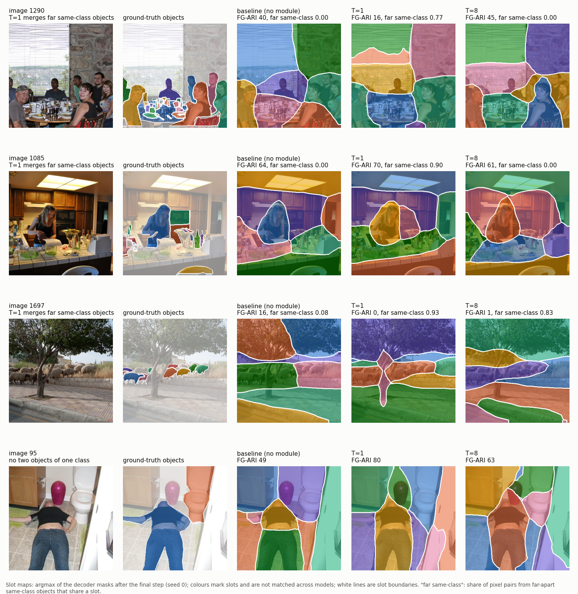
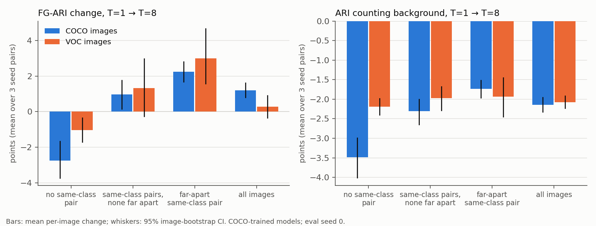
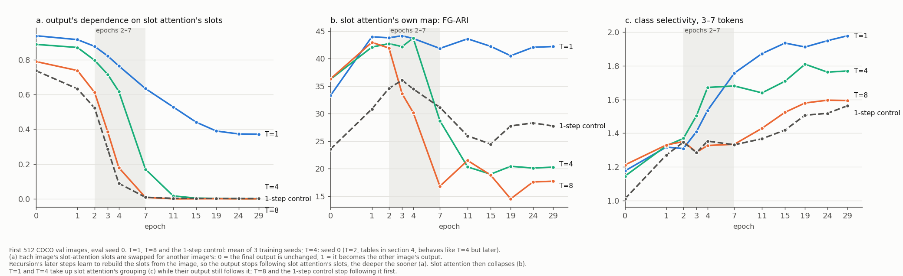

# What a recursive refinement module does in a slot-attention model

A short account of the recursion analysis. The evidence for each claim is in [recursion_mechanism.md](recursion_mechanism.md), produced by the scripts in [scripts/mechanism](../../../scripts/mechanism/). Numbers are 3-seed means on the 2,000 COCO validation images unless stated.

## Summary

TRM-style recursion applies one tiny block many times, with a loss after each step, and does well on reasoning puzzles. We add such a module after slot attention in a DINOSAUR-style model, and compare applying it once (T=1) with applying it 8 times (T=8), at the same parameter count.

T=8 raises FG-ARI by 1.2 points. The data do not credit that to recursion:

1. **The gain is a change of grouping, not better objects.** T=8's slots group patches by position, where T=1's group by appearance. A T=1 trained with a distance penalty, and no extra steps, reproduces T=8's slots and 79% of its FG-ARI gain. mBO, ARI counting background and reconstruction all get worse.
2. **The cause is a takeover that this design allows.** The module reads the image itself. Given several steps, it stops using slot attention's slots and builds the slots on its own. That happens whether the steps share weights or not. Of the models that do it, only the small shared block trained from scratch ends up grouping by position.
3. **Apart from that, the extra steps buy little, and shared weights none of it.** At equal parameters, 8 steps add 1.5 FG-ARI and 0.7 mBO_i to a model that already groups by appearance. At equal depth and parameters, a shared block scores slightly below a separate block per step. The best module models of the baseline's size are level with the no-module baseline read from slot attention's own map, not above it.

These are results about this module in this pipeline. Section 4 lists what they depend on.

## Setup

- **Model.** Frozen DINOv3 ViT-S/16 features at 336 px (21×21 = 441 patches) feed slot attention (7 slots, 3 iterations), then the refinement module, then a spatial-broadcast MLP decoder that reconstructs the DINO features. The only training signal is the reconstruction error. Segmentations are the decoder's masks, the standard readout for this decoder.
- **Module.** A 2-layer transformer block of width 256. Each layer has self-attention between the slots, cross-attention from the slots to the image patches, and an MLP.
  - One step runs the block twice: once to update a per-slot latent, once to update the slots. Slot attention's slots are fed in again at every step.
  - T=1 runs one step. T=8 runs 8 steps with the same weights, backpropagates through all of them, and has a loss after every step (weight 0.25 on steps 1–7).
  - The module is 2.5M of the model's 6.40M parameters. The no-module baseline has a wider decoder, so it also has 6.40M.
  - The project's first comparison used a narrower baseline of 3.89M parameters (`baseline`, one seed). T=8 scored 4.2 FG-ARI above it (seed 0 of each, mean of three evaluation seeds). Against the matched baseline the gap is 3.1 (3 seeds). Both come from the files in `results/coco/per_image/`.
- **Training.** A COCO 2017 subset: 25k training images, each with at least 3 non-crowd objects covering at least 0.5% of the image. 30 epochs (about 23k steps), 3 seeds per model.
- **Statistics.** Differences are paired per image and averaged over the three seed pairs. Brackets are 95% image-bootstrap intervals.
- **Grouping, measured without labels** on the 21×21 patch grid:
  - *far look-alikes in one slot*: the share of patch pairs more than 14 patches apart, with DINO feature cosine above 0.7, that share a slot;
  - *different-looking neighbours in one slot*: the same, for pairs at most 3 patches apart with cosine 0.2–0.3.
- **Class selectivity.** How often patches of two same-class objects 3–7 patches apart share a slot, divided by the same for two different-class objects. 1 means no preference.
- **Following slot attention.** Swap each image's slot-attention slots for another image's and see how far the output moves. 1 means all the way to the other image's output, so the module only refines what slot attention gives it. 0 means the output doesn't move, so the module builds the slots from the image by itself. Measured on the first 512 validation images.

## 1. T=8's FG-ARI gain is a change of grouping

| | baseline (no module) | T=1 | T=8 | T=1 + distance penalty |
|---|---|---|---|---|
| far look-alikes in one slot | 0.33 | 0.45 | 0.32 | 0.33 |
| different-looking neighbours in one slot | 0.24 | 0.07 | 0.15 | 0.14 |
| class selectivity | 1.30 | 1.86 | 1.50 | 1.45 |
| reconstruction error ×10³ | 33.6 | 29.7 | 33.6 | 33.1 |
| FG-ARI | 43.9 | 45.8 | 47.0 | 46.7 |
| mBO_i | 23.4 | 25.7 | 25.2 | 25.1 |
| mBO_c | 29.0 | 32.9 | 31.1 | 31.0 |
| ARI counting background | 21.6 | 24.1 | 22.0 | 22.5 |

*Figure 1. T=1 puts far-apart objects of one class in one slot. T=8 and the baseline split them by position (images 1290 and 1085). The same rule cuts a single object across slots (image 95). Seed-0 models.*

- **T=1 groups by appearance; T=8 groups by position.** T=1 puts far look-alikes together and keeps different-looking neighbours apart. T=8 does neither: on far look-alikes it is at the no-module baseline's level, and its reconstruction error equals the baseline's. Every seed shows this.
- **A distance penalty reproduces T=8 without any extra steps.** T=1 is trained with each slot's mask logit lowered in proportion to the squared distance from the mask's centre. It matches T=8's grouping, pays 86% of T=8's extra reconstruction error and gains 79% of its FG-ARI (+0.94 against +1.19). The gap to T=8, −0.25, is not significant.
- **FG-ARI rises only where it rewards splitting by position.** T=8 − T=1:
  - FG-ARI +1.2 [+0.8, +1.6] over all images;
  - +2.2 [+1.7, +2.8] in the 56% of images with two far-apart objects of one class;
  - −2.8 [−3.8, −1.8] in the 13% with no two objects of one class, where splitting by position only cuts objects.
- **Every other measure falls:** mBO_i −0.5 [−0.7, −0.3], mBO_c −1.9 [−2.1, −1.6], ARI counting background −2.1 [−2.3, −2.0], reconstruction error +13% (+11% to +16% by seed pair).
- **The gain depends on the image mix.** On VOC, 55% of images contain no two objects of one class. There the same models gain +0.3 [−0.4, +0.9] FG-ARI, with the same pattern by image group.
- **The slots encode less about what and more about where.** Linear probes on each object's best slot give class accuracy 0.639 for T=1 and 0.616 for T=8 (baseline 0.617; always guessing the majority class gives 0.31). Position R² is 0.678 for T=1 and 0.726 for T=8 (baseline 0.725).

*Figure 2. The change from T=1 to T=8 by image group, on COCO and VOC images (COCO-trained models).*

## 2. Why: the module takes over from slot attention

Slot attention groups patches by appearance within the first two epochs, in every model. At epoch 1 the class selectivity of its own attention map is 1.80 in T=1 and 1.81 in T=8. The decoder alone does not draw that grouping: it makes each mask from a slot vector and a position, and the baseline's output stays at 1.30 while its slot-attention map has 1.78. T=1's module writes the grouping into the slots over epochs 2–7.

The table sets out each model by what was varied. The last three columns are outcomes.

| model | steps | block weights | parameters | follows slot attention: epoch 4 / end | far look-alikes in one slot | class selectivity |
|---|---|---|---|---|---|---|
| 3 layers applied once | 1 pass | | 7.12M | 0.92 / 0.69 (seed 0) | 0.43 | 1.77 |
| T=1 | 1 | | 6.40M | 0.76 / 0.37 | 0.45 | 1.86 |
| T=2 (seed 0) | 2 | shared | 6.40M | 0.71 / 0.06 | 0.45 | 1.78 |
| T=4 (seed 0) | 4 | shared | 6.40M | 0.62 / 0.00 | 0.42 | 1.66 |
| **T=8** | 8 | shared | 6.40M | 0.18 / 0.00 | **0.32** | **1.50** |
| T=8, gradient cut between steps, as in TRM | 8 | shared | 6.40M | 0.09 / 0.00 | 0.40 | 1.45 |
| T=8, started from T=1's trained weights | 8 | shared | 6.40M | 0.09 after its first epoch (seed 0) | 0.45 | 1.78 |
| T=8, one wide block | 8 | shared | 23.5M | 0.75 / 0.12 | 0.42 | 1.77 |
| T=8, a block per step | 8 | separate | 23.5M | 0.03 / 0.00 | 0.43 | 1.76 |

*Figure 3. (a) How far the output follows slot attention's slots, labelled dependence. (b) The FG-ARI of slot attention's own map. (c) The output's class selectivity. T=4 (seed 0) and the model with the gradient cut between steps, labelled 1-step control, are also shown.*

- **More steps bring the takeover sooner, with shared weights or without.** At epoch 4 the output follows slot attention's slots 0.76 / 0.71 / 0.62 / 0.18 of the way for 1 / 2 / 4 / 8 steps, and 0.03 with a separate block per step. Every multi-step model ends at 0.12 or below. Once its slots are no longer used, slot attention stops segmenting (Figure 3b).
- **It needs the module's own view of the image.** Without cross-attention the module sees the image only through slot attention's slots. Then 8 steps change nothing: T=1 and T=8 group alike (far look-alikes 0.38 / 0.39) and reconstruct alike (error 36.7 / 36.6 ×10³). With cross-attention the same pair differs as on COCO (0.42 / 0.38; error 34.4 / 36.6). Both pairs are VOC-trained, one seed.
- **A takeover does not by itself give grouping by position.** Five of the multi-step models take over and still group mostly by appearance:
  - the separate blocks take over soonest and then learn the grouping themselves (class selectivity 1.56 at epoch 4, 1.86 at the end, on the 512 images);
  - T=2, T=4 and the wide block take over later, after their output has picked the grouping up from slot attention, and keep most of it;
  - the same small shared block, started from T=1's weights, keeps it.
- **Only the small shared block trained from scratch ends up grouping by position.** It takes over at epochs 2–4, before its output has picked up slot attention's grouping (class selectivity 1.33 at epoch 4, against T=1's 1.54), and learns little of it afterwards (1.59 at the end, against T=1's 1.98, on the 512 images). The losses on the intermediate steps are not the cause: with a loss on the final step only, class selectivity ends at 1.33 on all images.
- **The outcome is set early, and both outcomes are stable.**
  - T=8's weights from epoch 2, trained on with 1 step, pick up part of the grouping (class selectivity 1.63). From epoch 7 they can't (1.42).
  - T=8's final weights trained on with 1 step stay positional (1.48). T=1's final weights trained on with 8 steps stay appearance-based (1.78).
- **Not separated.**
  - Weight sharing and parameter count: the separate blocks have 3.7× the parameters, and 8 separate blocks with 2.5M parameters in total were not run.
  - Timing and the block: with slot attention held fixed from T=8's epoch 2, 8-step training still picks up little of the grouping (class selectivity 1.50, against 1.43 not held fixed and 1.63 for 1 step from the same weights). So an early takeover is not the whole reason.

## 3. What the extra steps buy

| model | parameters | FG-ARI | mBO_i | mBO_c | ARI counting background | error ×10³ |
|---|---|---|---|---|---|---|
| T=1 | 6.40M | 45.8 | 25.7 | 32.9 | 24.1 | 29.7 |
| T=8 | 6.40M | 47.0 | 25.2 | 31.1 | 22.0 | 33.6 |
| T=8, gradient cut between steps, as in TRM | 6.40M | 48.6 | 25.8 | 31.4 | 23.2 | 34.7 |
| T=8, started from T=1's trained weights | 6.40M | 47.4 | 26.3 | 33.1 | 24.2 | 31.1 |
| 1 step, started from T=1's trained weights (control) | 6.40M | 45.8 | 25.6 | 33.1 | 23.9 | 30.2 |
| T=8, one wide block | 23.5M | 47.5 | 26.3 | 33.0 | 23.8 | 31.1 |
| T=8, a block per step | 23.5M | 48.1 | 26.5 | 33.3 | 24.0 | 29.7 |
| no module, read from slot attention's own map | 6.40M | 48.0 | 26.1 | 32.8 | 25.0 | 33.6 |

- **Where the grouping is kept, 8 steps give a small gain without T=8's costs.** The three such models are 1.6–2.3 FG-ARI and 0.6–0.8 mBO_i above T=1, with mBO_c and ARI counting background within 0.4 of T=1's.
  - Only one of them has T=1's parameter count. Started from T=1's weights, 8 steps beat 1 step by +1.5 [+1.2, +1.9] FG-ARI and +0.7 [+0.5, +0.9] mBO_i, at 3% more reconstruction error.
  - That gain is +1.9 [+1.4, +2.3] in images with two far-apart objects of one class and 0.0 [−0.9, +0.8] in images with no two objects of one class, where T=8 loses 2.8.
  - For the two 3.7× models, no 1-step model of that size exists to compare with.
- **Shared weights are not the source.** At the same depth and parameter count, the shared wide block is below the separate blocks on every measure, in every seed: FG-ARI −0.6 [−0.9, −0.2], and mBO_i, mBO_c and ARI counting background 0.2–0.3 lower. Its reconstruction error is 5% higher.
- **Cutting the gradient between steps, as TRM does, gives the highest FG-ARI and a milder form of T=8's trade.** Against T=1 it gains 2.9 FG-ARI [+2.4, +3.3] and loses 1.5 mBO_c and 0.9 ARI counting background, with 17% more reconstruction error and mBO_i unchanged.
- **The steps are used at test time, but they do not refine slot attention's slots.** The models spread the work over their steps: FG-ARI is 40.8 after T=8's first step and 47.0 after its eighth, against 45.8 for T=1's single step. By the end of training none of it depends on slot attention's slots (section 2). Running T=8 for 16 steps leaves FG-ARI at 47.0.
- **No model of the baseline's size is clearly better than slot attention's own map.**
  - Against the no-module baseline read from that map, T=1 is 2.2 FG-ARI lower and T=8 1.0 lower.
  - The 8-step model started from T=1's weights is level with it: −0.6 FG-ARI, +0.3 mBO_i, +0.3 mBO_c, −0.8 ARI counting background.
  - The model with the gradient cut between steps is 0.6 FG-ARI above it, and 1.4 mBO_c and 1.7 ARI counting background below.
  - Slot attention is itself one update applied repeatedly with shared weights. Run for 8 iterations instead of 3 at test time, with no retraining, its map reaches 49.3 FG-ARI.
  - The module does not behave that way. T=1's block run for 8 steps at test time collapses (FG-ARI 15.1).

## 4. What these results depend on

- **The module can read the image.** The takeover runs through its cross-attention (section 2).
- **The module sits behind slot attention.** Two parts of the model can each form the slots, so one can displace the other. Where the repeated block is the only part that groups, as when slot attention itself is run for more iterations, there is nothing to displace. Slot attention was later trained that way (8 iterations with a loss on each and the gradient cut between them, 3 seeds). On COCO its map scores 49.0 / 27.4 / 34.4 FG-ARI / mBO_i / mBO_c, about 1 point of mBO above the baseline run for 8 iterations, with FG-ARI level. The gain did not replicate on PASCAL VOC. Its first seed does not move towards grouping by position. The two loops are drawn side by side in [the two recursions](../../../docs/two_recursions.md).
- **The block is small.** The same recursion with a wider shared block ends up grouping by appearance.
- **The decoder and the readout.** The MLP decoder's masks group by position even when slot attention's map does not (section 2). Seitzer et al. (2023) report the same split between decoders: their MLP decoder leans towards instance-level grouping, with higher FG-ARI, and their Transformer decoder towards class-level grouping, with higher mBO. T=1 and T=8 sit at different points on that axis.
- **The data.** One COCO subset, frozen DINOv3 features, 7 slots. "Appearance" here means similarity of those features, which is largely semantic.

## What this means

- **T=8's FG-ARI gain is not evidence that recursion helps object discovery.** It comes with grouping by position, which a distance penalty gives in one step, and FG-ARI alone would have reported it as an improvement. mBO, ARI counting background and both readouts show the trade.
- **Nothing here is specific to sharing weights across steps.** The takeover goes with the number of steps. Grouping by position goes with one small block trained from scratch. At matched size and depth, shared weights score slightly lower than separate ones.
- **A refiner that can read the input may stop refining.** The swap test in section 2 checks this with forward passes only.

## Limitations

- One training set (a 25k-image COCO subset, about 23k steps) at 3 seeds, one backbone, 7 slots and one decoder. Absolute scores are not comparable to published full-COCO results.
- T=2 and T=4 are one seed each. The pair without cross-attention is one seed, trained on VOC and scored on COCO images.
- Slot attention trained with 8 iterations was tested separately with 3 seeds and four controls; the results and their limits are in [the two recursions](../../../docs/two_recursions.md). A version with full backpropagation through the iterations is noted in the run script as unstable and was not scored.
- The two larger models have 3.7× the parameters. There is no 1-step model of that size, and no model with separate blocks at T=8's size.
- The module called "3 layers applied once" has 11% more parameters than T=1.
- The per-epoch measures use the first 512 validation images and one checkpoint per epoch, so events within an epoch can't be ordered.

## References

- Locatello et al. (2020). Object-Centric Learning with Slot Attention. NeurIPS.
- Seitzer et al. (2023). Bridging the Gap to Real-World Object-Centric Learning. ICLR.
- Jolicoeur-Martineau (2025). Less is More: Recursive Reasoning with Tiny Networks. arXiv.
